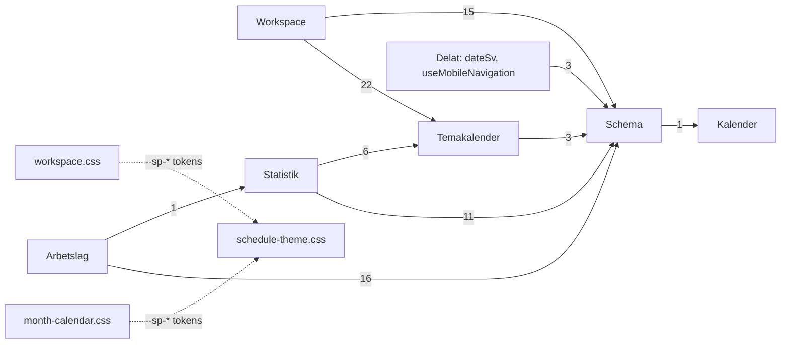

# Arkitekturgranskning: drive_c_frontend + drive_c_backend

Datum: 2026-10-15. Underlag: `main` i båda repona (frontend `12f466f`, backend `072541e`),
git-historik 2026-04-15 – 2026-10-15 (frontend 180 commits utan merge, backend 58).
Det här är en granskning. Ingen kod är ändrad.

Kontrollerat vid granskningen: frontend `pnpm test` ger 514 gröna tester, `tsc --noEmit` är rent och
`pnpm lint` ger 1 varning. Backend `pytest` ger 301 gröna tester och 5 758 varningar på en
nyinstallerad miljö (SQLAlchemy 2.1.4, PyJWT 2.15.1).

---

## 0. Läget 2026-10-16

Rapporten är kontrollerad mot `main` i båda repona en dag efter granskningen (frontend `1897fec`,
backend `783f479`). Fynden och planen nedan står kvar som de skrevs. Den här tabellen visar vad
som har hänt sedan dess. CI är grön på `main` i båda repona.

| Steg / fynd | Status | Belägg |
|---|---|---|
| 1. CI (F1) | **Klart** | FE `4def45e` kör tsc, lint, test och bygge. BE `ee38961` kör pytest och kräver exakt en alembic-head, på Python 3.10. |
| 2. `CLAUDE.md` och planindex (F2) | **Klart, men med luckor** | FE `56d07c9`, BE `d37d5cb`; `docs/plans/README.md`; statusraderna rättade; granskningarna från mars flyttade till `docs/arkiv/`. Se luckorna nedan. |
| 3. Fixtures i vitest (F3) | **Klart** | `3dc5adc`: `scheduleFixtures.test.ts`, plus `planningTime.test.ts` och `scheduleRules.test.ts`. |
| 4. Backendhygien (F5) | Kvar | Alla filer i avsnitt 6 finns kvar. `requirements.txt` är oförändrad (inklusive `bcrypt`). `ping_connection` har den gamla signaturen. |
| 5. Modellregister och migrationstester (F4) | **Delvis** | Head-kontrollen finns i CI. Modellerna importeras fortfarande på tre ställen, och T3 (jämförelse mot modellerna) och T4 (`app.py`) saknas. |
| 6. `services/http.ts` (F14) | Kvar | `readData` i 3 kopior, `unwrap` i 2, plus egen variant i `plannerService`. |
| 7. `api/validation.py` (F7) | Kvar | `PayloadError` i 3 kopior. |
| 8. Inställningsregister och backup (F10) | Kvar | JSON-backupen saknar fortfarande `selectionDefaults`, `pasteProtect` och `exportExcludes`. |
| 9–11. Dela upp NSP (F13, F17) | Kvar, **filen växer** | NSP har 2 631 rader (+9), `useArchiveManager` 733 (+31). `isReadOnlyRef` och `saveNowRef` finns kvar. `BulkEditModal` växte med cirka 290 rader (`a860c7e`). |
| 12–13. Elementtyper och workspace (F11, F15) | **Delvis** | Ångrastacken är utlyft och testad (`undoStack.ts`, `4d9fecb`). Inget `elementTypes.ts`, och `useWorkspaceData` har 1 280 rader. |
| 14. API-kontrakt (F12) | Kvar | Ingen `CLAUDE.md` nämner camelCase/snake_case eller vilka frontendtyper som speglar backend. |
| 15. Dela upp `planner_routes` (F16) | Kvar, **filen växer** | 1 292 rader (+70 för versionen i `bfc6f4f`). `/courses` och `/sections` finns kvar. |
| F9, F18, F19, F20 | Kvar | `LessonLab.tsx` 1 356 rader; två regex för veckonummer; featurelistan i två kopior. |

**Nytt sedan granskningen, och hur det påverkar fynden:**
- **Hooktester går nu att skriva.** `usePlannerSync.test.ts` (`3897dda`) kör jsdom via `// @vitest-environment jsdom` och en egen `renderHook` utan testbibliotek. Konfigurationen behöver alltså inte ändras före steg 11, och T7 kan skrivas på samma sätt.
- **Schemat har fått versionskontroll** (BE `021_planner_archive_version`, FE `ArchiveConflictError` och `ArchiveConflictDialog`). Schema och Arbetslag använder nu samma samtidighetsmodell (version och 409). F6:s beslutstabell kan förenklas: ett dokument som sparas helt och kan öppnas på flera ställen ska ha en version.
- **Deployordningen är inte längre enhetlig.** `021` ska ut med frontend först (`DEPLOY.md`), medan 019–020 krävde backend först. Frontendens `CLAUDE.md` säger fortfarande generellt att migrationen ska vara deployad före frontend. Regeln bör hänvisa till `DEPLOY.md` i stället.

**Luckor i de `CLAUDE.md` som mergades**, jämfört med utkasten:
- Fällan med `commitSchedule` och `applyScheduleFromServer` i schemat.
- Checklistan för en ny dold inställning (F10) och för en ny elementtyp, inklusive backendens `VALID_TYPES` (F11).
- Nyckelstilen per feature och vilka typer som speglar vilka serializers (F12, alternativ A).
- Vilken sparmodell en ny feature ska följa (F6).
- I backend: att modellerna registreras på tre ställen (F4), och att ForeignKey ger MySQL-fel 3780.

**Föreslagen ordning härifrån:** steg 4 (hygien, under en timme), sedan att komplettera båda `CLAUDE.md`
med luckorna ovan (under en timme), sedan steg 8 (backupen, det enda fynd där data redan saknas,
och förberedelsen för att dela upp NSP).

---

## 1. Sammanfattning

1. Koden är genomgående välkommenterad, och de rena delarna (`src/utils`, backendens routes) har bra tester. Risken sitter i **fyra stora frontendfiler** som tar emot nästan varje feature: `NewSchedulePlanner.tsx` (46 ändringar på 6 mån), `LessonLab.tsx`, `useWorkspaceData.ts` och `WorkspaceShell.tsx`. Ingen av dem har några tester.
2. **Inget kör testerna automatiskt.** Repona saknar CI och `CLAUDE.md`, och planerna i `docs/plans/` har inaktuella statusrader. En ny session har därför ingen pålitlig bild av hur koden ser ut eller hur den verifieras.
3. Flera saker måste ändras på många ställen samtidigt. En ny dold schemainställning kräver 12 ändringar i 5 filer, och JSON-backupen har redan glidit isär. En ny workspace-elementtyp har rört 14–16 filer. API-kontraktet mellan repona finns bara i huvudet.
4. Gör inga stora flyttar eller ramverk. De tre första stegen tar vardera under en timme: CI, `CLAUDE.md` med planindex, och att flytta dev-konsolens fixturekontroller in i vitest. Därefter kan de stora filerna delas upp i små PR:er bakom tester.

---

## 2. Featurekarta och beroenden

### 2.1 Tabell

| Feature | Frontend: route → rot | Hooks / services / utils (urval) | Backend: blueprint → modeller | Tester |
|---|---|---|---|---|
| **Schema** (planner) | `/` och `/features/schedule` → `components/schedule/NewSchedulePlanner.tsx`; `/s/[token]` → `schedule/public/*`; `dev-planning-check` | `useArchiveManager`, `usePlannerSync`, `useHiddenSettings`, `useDragHandlers`, `useCourseManager`, `useKeyboardPlacement`, `useScheduleKeyboardNav`, `useScheduleSelections`, `useNotesMarquee`, `useScheduleVectorExport`; `plannerService`, `publicScheduleService`; `utils/schedule*`, `planningTime`, `bulkEditSchedule`, `findReplaceSchedule`, `*Triggers`, `schedulePdf/*`; `types/schedule.ts`; `config/plannerConstants.ts`; `styles/schedule-theme.css` | `planner_routes.py` (`/api/planner`, 23 routes) → `planner_models.py` (Activity, Archive, ArchiveShare, Course, PublicLink) | BE: 4 filer, god täckning. FE: utils, men inte `planningTime`, `scheduleRules`, `scheduleStats`, hooks eller komponenter |
| **Temakalender** | `/features/temakalender` → `theme-wheel/ThemeWheelPlanner.tsx` | `useThemeWheelSync`, `useThemeWheelExport`, `useWheelInteraction`; `themeWheelService`; `utils/themeWheel*` | `theme_routes.py` (`/api/theme`) → `theme_models.py` | BE: `test_theme_wheel`. FE: bara `themeWheelLayout` |
| **Statistik / terminsplanering** (dold) | `/features/statistik` → `term-planner/TermPlanner.tsx` | `termService`; `utils/termPlanner.ts` | `term_routes.py` (`/api/terms`) → `term_models.py` | BE: `test_planner_term`. FE: `termPlanner.test` |
| **Arbetslag** (lesson lab) | `/features/arbetslag` (+`/detalj`) → `lesson-lab/LessonLab.tsx`, `LessonLabDetail.tsx` | `useLessonLabState`, `useLabArchive`; `arbetslagService`; `utils/lessonLab*`, `labPlanStore`, `labPlans`, `labExport` | `arbetslag_routes.py` → `arbetslag_models.py` | Båda repona, god täckning av logiken |
| **Kalender** (månad) | `/features/calendar` → `month-calendar/CalendarShell.tsx` | `useCalendarData`, `useCalendarAutosave`; `monthCalendarService`; `calendarDates`, `dateSv`; `styles/month-calendar.css` | `month_calendar_routes.py` (`/api/calendar`) → `month_calendar_models.py` | BE: `test_month_calendar`. FE: datumlagret |
| **Workspace** (canvas) | `/workspace` → `app/workspace/_feature/` (66 filer, organiserade per feature) | `useWorkspaceData`, `useWorkspaceSync`, `useWorkspaceHistory`, `useProvenance`; `workspaceService`, pdf-/bildproxy; `workspace.css` | `workspace_routes.py`, `pdf_proxy_routes.py`, `image_proxy_routes.py` → `workspace_models.py`; `services/pdf_proxy.py`, `image_proxy.py` | BE: 5 filer. FE: 3 utils, men inte reducern |
| **Bibliotek** | `/features/bibliotek` → `page.tsx` (250 rader, anropar API direkt) + `FileList/*` | `useDragSort`; `libraryTree`, `librarySync` | `routes.py` (`/api/files`, `/api/update`) → `DriveFile` i `services/db_config.py`; `services/drive_connect.py` | BE: drive-sync. FE: utils |
| **Delat** | `RootLayoutBase`, `FeatureNavigation`, `ProtectedRoute`, `components/ui/*` | `AuthContext`, `authService.fetchWithAuth`, `usePersistentState`, `useHotkeys`, `useUndoableState`, `usePlannerNotice`, `utils/download`; `styles/tokens.css`, `globals.css` | `auth_routes.py`, `responses.py`, `services/db_retry.py`, `rate_limit.py` | `auth_routes` saknar tester |
| *Utan anropare* | – | – | `notes_routes.py` (`/api/notes/*`, 387 rader), `/api/sections`, `/api/planner/courses*`; modeller för borttagna features (`calendar.py`, `schedule_models.py`, `command_center_models.py`) | – |

### 2.2 Beroenden mellan features (frontendimporter)

Antalet importrader står på pilarna. Grafen innehåller inga cykler mellan features. På filnivå finns en enda cykel: `HeadingToolbar.tsx ↔ editors/HeadingEditor.tsx`.

**Slutsats:** Schema har i praktiken blivit appens delade kärna. `types/schedule.ts` importeras från 63 ställen, `config/plannerConstants.ts` från 30 och `utils/scheduleTime.ts` från 28, och alla andra features utom Kalender importerar från Schema. Temakalendern läser t.ex. `AUTOSAVE_DELAY_MS` ur `plannerConstants`, och workspace använder `usePlannerNotice` som sitt notissystem. Det kostar inget i dag. Men varje ändring i `types/schedule.ts` (10 ändringar, i snitt 11 filer per commit) kan nå fem features, och namnen säger "planner" om saker som är generella.

---

## 3. Hotspots: de 20 filer som ändrats oftast

Tabellen räknar commits utan merge mellan 2026-04-15 och 2026-10-15 i båda repona. Filer som har tagits bort (`schedule/constants.ts`, `DebugPanels.tsx`) är inte med. "Snitt filer/commit" är medianen av hur många filer som ändrades i samma commit som filen.

| # | Repo | Fil | Ändr. | Rader | Snitt filer/commit | Tester | Bedömning |
|---|---|---|---|---|---|---|---|
| 1 | FE | `components/schedule/NewSchedulePlanner.tsx` | 46 | 2 622 | 8 | inga | Gudkomponent. Se F13 |
| 2 | FE | `components/lesson-lab/LessonLab.tsx` | 26 | 1 356 | 4 | inga (utils testade) | ~800 rader inline-subkomponenter. Se F9 |
| 3 | FE | `app/workspace/_feature/styles/workspace.css` | 20 | 2 743 | 6 | – | Ändras i 12 av 18 commits till `useWorkspaceData`. Se F8 |
| 4 | FE | `app/workspace/_feature/hooks/useWorkspaceData.ts` | 18 | 1 273 | 7 | inga | Fem ansvarsområden. Se F15 |
| 5 | FE | `components/FeatureNavigation.tsx` | 17 | 218 | 8 | inga | Featurelistan finns i två kopior. Se F19 |
| 6 | FE | `app/workspace/_feature/components/WorkspaceShell.tsx` | 16 | 965 | **13** | inga | Menybygge, urklipp och dragning i skalet. Se F15 |
| 7 | FE | `hooks/useHiddenSettings.ts` | 12 | 193 | **11** | inga | Varje ny inställning sprids över 5 filer. Se F10 |
| 8 | FE | `components/schedule/ScheduledEventCard.tsx` | 12 | 209 | – | inga | Ändras med NSP (12 ggr). OK som den är |
| 9 | FE | `app/workspace/_feature/types/constants.ts` | 12 | 230 | **14** | – | Konstanter per elementtyp. Se F11 |
| 10 | FE | `app/workspace/_feature/components/CanvasElement.tsx` | 12 | 373 | – | inga | Typspecifika grenar. Se F11 |
| 11 | FE | `app/globals.css` | 12 | 289 | 11 | – | Temaväxling. Se F8 |
| 12 | BE | `app.py` | 12 | 196 | – | **körs aldrig i test** (conftest bygger egen app) | Modellregister och `create_all`. Se F4 |
| 13 | BE | `api/planner_routes.py` | 11 | 1 222 | – | god | Tre delområden i en fil. Se F16 |
| 14 | FE | `types/schedule.ts` | 10 | 178 | **11** | – | Delad kärna, 63 importörer |
| 15 | FE | `styles/schedule-theme.css` | 10 | 299 | – | – | Ägs av Schema men läses av Kalender och workspace. Se F8 |
| 16 | FE | `config/shortcuts.ts` | 10 | 77 | – | – | Hjälptexten speglar `FeatureNavigation`. Se F19 |
| 17 | FE | `components/term-planner/TermPlanner.tsx` | 10 | 538 | – | inga (utils testade) | Egen sparlogik inline. Se F6 |
| 18 | FE | `components/schedule/public/PublicScheduleView.tsx` | 10 | 334 | – | inga (filter testat) | OK |
| 19 | FE | `components/schedule/public/PublicDayList.tsx` | 10 | 187 | – | inga | OK |
| 20 | BE | `api/workspace_routes.py` | 10 | 662 | – | god (5 filer) | Måttlig. Valideringen dubblerad. Se F7 |

Ingen av de sex frontendfiler som ändras oftast har något test. Backendens hotspots är däremot välskyddade, med undantag av `app.py`.

---

## 4. Fyndtabell

**Påverkan:** H = kostar tid eller orsakar fel varje månad, M = några gånger per kvartal, L = sällan.
**Insats:** S = under en timme, M = under en dag, L = mer än en dag.
Tabellen är sorterad på kvoten påverkan delat med insats (H=3, M=2, L=1 och S=1, M=2, L=3).

| ID | Påverkan | Insats | Kvot | Repo | Plats | Rubrik |
|---|---|---|---|---|---|---|
| F1 | H | S | 3 | båda | `.github/` saknas | Inget kör tester, typkontroll eller lint automatiskt |
| F2 | H | S | 3 | båda | `docs/plans/*`, `DESIGN_AUDIT.md`, `vitest.config.ts` | Ingen `CLAUDE.md`, planernas statusrader stämmer inte och dokumenten beskriver borttagen kod |
| F3 | H | S | 3 | FE | `components/schedule/planningValidation.ts`, `layoutValidation.ts`, `__fixtures__/` | 659 rader fixtures körs i dev-konsolen i stället för i vitest |
| F4 | M | S | 2 | BE | `app.py:157–185`, `tests/conftest.py:17`, `migrations/env.py:10` | Modellerna registreras på tre ställen, och migrationerna kontrolleras inte |
| F5 | M | S | 2 | BE | `requirements.txt`, `lib/`, rotskript | Ospärrade beroenden, vendorad PyJWT och trasiga engångsskript |
| F6 | M | S | 2 | FE | 6 sparimplementationer | Sex sparmodeller utan regel för vilken en ny feature ska använda |
| F7 | M | S | 2 | BE | `theme_routes.py:59`, `term_routes.py:43`, `arbetslag_routes.py:58` | Valideringshjälpare och `PayloadError` kopierade mellan routes |
| F8 | M | S | 2 | FE | `tokens.css`, `workspace.css`, `month-calendar.css`, `kron:` | Tre sätt att uttrycka en temaskillnad, och regeln står bara i en plan |
| F9 | M | S | 2 | FE | `LessonLab.tsx:537–1356` | Tolv subkomponenter inline i en fil som ändras ofta |
| F10 | H | M | 1,5 | FE | `useHiddenSettings.ts`, `NewSchedulePlanner.tsx:881–1000` | En ny inställning kräver 12 ändringar i 5 filer, och backupen har redan glidit isär |
| F11 | H | M | 1,5 | FE+BE | `useWorkspaceData.ts:47`, `ElementRenderer.tsx`, `constants.ts`, `workspace_models.py:69` | En ny elementtyp rör 14–16 filer |
| F12 | H | M | 1,5 | båda | services ↔ serializers | API-kontraktet hålls synkat bara i huvudet, och nyckelstilen varierar mellan features |
| F13 | H | L | 1 | FE | `NewSchedulePlanner.tsx` | Gudkomponent på 2 622 rader med hookordning som hålls ihop av refs |
| F14 | M | M | 1 | FE | `src/services/*.ts`, `_feature/services/*` | Fem varianter av `unwrap`/felhantering och okontrollerade `as T` |
| F15 | M | M | 1 | FE | `useWorkspaceData.ts`, `WorkspaceShell.tsx` | Skrivpipeline, ytor, importer, geometri och menyer i två filer |
| F16 | M | M | 1 | BE | `planner_routes.py` | Tre delområden i 1 222 rader, och kaskadraderingen finns i två kopior |
| F17 | M | M | 1 | FE | `useArchiveManager.ts` | Arkivlista, lås, dialogstate för nytt schema och legacy-import i en hook |
| F18 | L | S | 1 | FE | `useArchiveManager.ts:40`, `termPlanner.ts:200` | Veckonumret läses ur schemanamn med två olika regex |
| F19 | L | S | 1 | FE | `FeatureNavigation.tsx:37`, `config/shortcuts.ts:16` | Featurelistan och genvägarna finns i två kopior |
| F20 | L | S | 1 | FE | 17 filer med `localStorage` direkt | localStorage-nycklarna är utspridda, och användardata finns bara i webbläsaren |
| F21 | L | L | 0,33 | FE | `src/` | Två organisationsmönster (per feature eller per filtyp) |

---

## 5. Fynden i detalj

### F1 – Inget kör testerna automatiskt (H/S, båda)

**Problem.** Inget av repona har `.github/workflows` eller någon annan CI. Frontendens 514 tester, `tsc` och lint körs bara om sessionen kommer ihåg det. Backendens 301 tester körs bara om någon skapar en virtualenv. Repona har 186 fjärrgrenar från AI-sessioner (`ccr-*`, `claude/*`, `codex/*`), och 47 PR:er har mergats på sex månader.

**Vad blir dyrare.** Varje refaktorering i planen nedan. Ett exempel från historiken: `d31692a` ("En gemensam ångra-funktion för schemat och temahjulet") rörde två features samtidigt. Om något hade gått sönder där hade ingen kontroll sagt till före merge.

**Förslag.** Lägg till ett jobb per repo. Frontend: `pnpm install --frozen-lockfile && pnpm lint && pnpm exec tsc --noEmit && pnpm test`. Backend: `pip install -r requirements-dev.txt && python -m pytest`. Lägg inte till coverage-krav eller matriser.

**Första steget.** Lägg till `.github/workflows/ci.yml` i varje repo (se steg 1 i planen).

### F2 – Ingen `CLAUDE.md`, och dokumenten stämmer inte (H/S, båda)

**Problem.**
- Ingen `CLAUDE.md` finns. Konventionerna finns bara i kodkommentarer (som är bra) och i sex planer på sammanlagt 2 574 rader.
- Fem av sex planer har statusraden "genomförd … **inte sammanslagen med main**", till exempel `basscheman.md:3`, `kronberg-tema.md:3` och `workspace-editorer-tokens.md:3`. Alla fem är sammanslagna (`912bc5a` och `777c4d0` finns på `origin/main`).
- `DESIGN_AUDIT.md` (2026-03-06) granskar `src/components/familjeschema/`, som inte finns längre.
- `vitest.config.ts:5` säger att "Vitest täcker i dagsläget bara datumlagret" och hänvisar till "KALENDER-planen", som inte finns. Vitest kör i dag 36 testfiler.
- `planningValidation.ts:45` säger "Projektet har ingen testkörare".

**Vad blir dyrare.** Varje ny session. En session som läser `planningValidation.ts` lägger nya fall i dev-konsolens fixtures i stället för i vitest. En session som läser `DESIGN_AUDIT.md` letar efter `neobrutalism.css`. Planer märkta "inte sammanslagen" kan få en session att tro att koden inte finns på main.

**Förslag.** Lägg till `CLAUDE.md` i båda repona (utkasten levereras med rapporten) och `docs/plans/README.md` med en rad per plan i formatet "status · datum · vad den styr i dag". Flytta `DESIGN_AUDIT.md` och `SECURITY_AUDIT.md` till `docs/archive/`, eller lägg en rad överst om att de är historiska. Rätta de två kommentarerna.

**Första steget.** Steg 2 i planen.

### F3 – Fixturekontroller körs i dev-konsolen i stället för i vitest (H/S, FE)

**Problem.** `NewSchedulePlanner.tsx:737–741` kör `runLayoutFixtureValidation()` och `runPlanningFixtureValidation()` vid varje montering i dev. De kontrollerar 659 rader fixtures (`__fixtures__/planningTime.ts`, `layoutTorture.ts`, `exportExclusions.ts`) med `console.assert`-liknande anrop. Utanför dev körs de aldrig. Samtidigt saknar `utils/planningTime.ts` (308 rader, 6 ändringar) och `utils/scheduleRules.ts` (218 rader) egna vitest-tester.

**Vad blir dyrare.** Varje ändring av planeringsvyn ("Tobias planering"), till exempel `c6a4f62` (arbetsdagens gränser) och `be2c0a3` (lärarens fria tid). Ett fel syns bara om någon har dev-konsolen öppen på schemasidan. Det gäller också uppdelningen av NSP (F13), som måste behålla beteendet.

**Förslag.** Gör de två `run*`-funktionerna till `describe`-block i `planningTime.test.ts` och `scheduleLayout.test.ts`, och använd samma fixtures. Ta sedan bort anropen och importerna i NSP.

**Första steget.** Steg 3 i planen.

### F4 – Modellerna registreras på tre ställen, och migrationerna kontrolleras inte (M/S, BE)

**Problem.** Alla modeller importeras för hand på tre ställen: `app.py:157–185` (för `db.create_all()` vid import), `tests/conftest.py:17–31` och `migrations/env.py:10–20`. Migrationerna har handskrivna id:n (`001_…`–`020_…`), och inget test kontrollerar att kedjan har ett enda huvud eller att modellerna stämmer med migrationerna. `app.py` körs aldrig i test, eftersom conftest bygger en egen app.

**Vad blir dyrare.** En ny feature med en ny tabell, som `016_planner_term` eller `017_arbetslag_plan`. Glömmer man en av de tre importerna fungerar testerna men inte alembic, eller tvärtom. Två parallella sessioner som båda skapar `021_…` ger två huvuden, och då faller `python -m alembic upgrade head` på PythonAnywhere först vid deploy. `DEPLOY.md` beskriver deployen noga, men inget fångar felet tidigare.

**Förslag.** Lägg till `models/__init__.py`, som importerar alla modeller, och låt de tre ställena importera bara `models`. Lägg till två tester. Det första kontrollerar att `ScriptDirectory.get_heads()` har längden 1. Det andra kör `alembic upgrade head` mot en tom SQLite-fil och jämför med `compare_metadata`, med en lista över de kända avvikelserna.

**Första steget.** Steg 5 i planen.

### F5 – Ospärrade beroenden, vendorad PyJWT och trasiga engångsskript (M/S, BE)

**Problem.**
- `requirements.txt` spärrar bara `alembic` och `python-dotenv`. En ny installation i dag ger SQLAlchemy 2.1.4, Flask 3.1.3 och PyJWT 2.15.1. Testerna går igenom, men med 5 758 varningar. De flesta kommer från `services/db_config.py:14`, där `engine_connect(connection, branch)` har den gamla signaturen, som SQLAlchemy säger ska tas bort i en kommande version. PythonAnywhere kör utan virtualenv (`DEPLOY.md:36`), så produktionens versioner framgår inte av repot.
- `lib/jwt` är PyJWT 2.10.1, installerad med `pip --target`, med incheckade `cpython-310.pyc`. Inget i repot lägger till `lib/` i `sys.path`, och `lib/` har ingen `__init__.py`. Lokalt och i test importeras därför PyJWT från site-packages (2.15.1, verifierat). Dessutom ignorerar `.gitignore` `lib/`, så katalogen är incheckad mot repots egen regel. Bara WSGI-filen på PythonAnywhere, som ligger utanför repot, kan avgöra om `lib/` används i produktion.
- `bcrypt` står i `requirements.txt` men används inte. Lösenorden hashas med `werkzeug.security` (`models/user.py:3`).

**Vad blir dyrare.** En ominstallation på PythonAnywhere, eller en ny dev-maskin, kan ge en annan SQLAlchemy än den testerna kördes mot. En session som ser `lib/jwt` kan dessutom tro att den ska patcha den kopian.

**Förslag.** Se hygienlistan i avsnitt 6. Spärra versionerna med `==` till det som körs på PythonAnywhere (`pip freeze` där). Det kräver inget lockverktyg. Uppdatera `ping_connection` till den nya signaturen.

### F6 – Sex sparmodeller utan regel för vilken en ny feature ska använda (M/S, FE)

**Problem.** Varje feature har sin egen sparlogik:

| Feature | Var | Modell | Samtidighet | Vid stängning |
|---|---|---|---|---|
| Schema | `usePlannerSync.ts` | hela dokumentet, signaturjämförelse, 1 s debounce | lås (409, `ArchiveLockedError`) | släpper låset med `pagehide` och keepalive; ingen flush |
| Temakalender | `useThemeWheelSync.ts` | hela dokumentet, kanonisk ögonblicksbild, utkast i localStorage | ingen | – |
| Kalender | `useCalendarAutosave.ts` | patch per dag som slås ihop | ingen | `beforeunload` och keepalive-flush |
| Workspace | `useWorkspaceData.ts:80` + `useWorkspaceSync.ts` | ett anrop per ändring, nyckelad debounce | ingen | `pagehide`/`visibilitychange`-flush |
| Statistik | `TermPlanner.tsx:150` (inline) | en timer och en versionsräknare | ingen | varnar med `beforeunload` |
| Arbetslag | `utils/labPlanStore.ts` | kö på modulnivå per upplägg | version (409, `PlanConflictError`) | flush vid unmount, testad |

Typen `'idle' | 'saving' | 'saved' | 'error'` är definierad fyra gånger (`useWorkspaceSync.ts:6`, `useCalendarAutosave.ts:9`, `useThemeWheelSync.ts:14`, `usePlannerSync.ts:101`). Arbetslag och Statistik har dessutom egna varianter med `'pending'`/`'conflict'`.

**Bedömning.** Skillnaderna är **verkliga**: hela dokumentet, patchar och anrop per ändring passar olika datamodeller, och kommentarerna förklarar varför (till exempel `useWorkspaceHistory.ts:18`). En gemensam sparmotor skulle inte bära sin egen vikt. Problemet är att ingen regel säger vilken modell en ny feature ska välja, eller vad som krävs vid stängning. Varje ny feature hittar därför på sin egen.

**Vad blir dyrare.** Nästa feature som sparar till backend, till exempel om Statistik får delning som Arbetslag. Sessionen kopierar den modell den råkar läsa först.

**Förslag.** Skapa ingen ny abstraktion. Lägg en beslutstabell i `CLAUDE.md` (finns i utkastet): ett dokument som sparas helt följer `labPlanStore` (testad och versionerad), och data som ändras per fält följer `useCalendarAutosave`. Flytta `SaveStatus` till `types/save.ts` och låt de fyra kopiorna importera den. Lyft ut sparlogiken ur `TermPlanner.tsx` till `useTermSync`, men bara om Statistik ändras igen.

### F7 – Valideringshjälpare och `PayloadError` kopierade mellan routes (M/S, BE)

**Problem.** Flera hjälpare finns i mer än en kopia:
- `PayloadError` finns i 3 kopior (`theme_routes`, `term_routes`, `arbetslag_routes`).
- `_text` och `_integer` finns i 2 kopior var (theme och term), med små skillnader: theme har `default=`, term har inte.
- `_client_id`, `_usernames_for` och `_has_access` finns i 2 kopior var (planner och arbetslag).

Varje route fångar dessutom `PayloadError` med sin egen `try/except`.

**Vad blir dyrare.** Nästa route med indatavalidering. Den förra (`5055322`, terminer) kopierade `_text` från theme och tappade `default`. Dessutom blir en ändring av felformatet till många ändringar.

**Förslag.** Skapa `api/validation.py` (cirka 60 rader) med `PayloadError`, `text()`, `integer()`, `color()` och `client_id()`, och registrera en `errorhandler(PayloadError)` i `create_app` och i conftest som svarar 400 via `error_response`. Flytta `usernames_for` till `models/user.py`. Låt `_has_access` ligga kvar per feature: delningsmodellerna är olika tabeller, och en generisk delningstjänst vore ett ramverk. Mer än så behövs inte.

**Första steget.** Steg 7 i planen. Flytta en blueprint i taget (term först, den är minst). Testerna för theme, term och arbetslag täcker redan felaktig indata.

### F8 – Tre sätt att uttrycka en temaskillnad (M/S, FE)

**Problem.** Tokensystemet är välbyggt: `tokens.css` definierar `--ui-*` för Neo och Kronberg, och `--sp-*`, `--ws-*` och `--mc-*` läser därifrån. Men en Kronberg-skillnad kan uttryckas på tre sätt:
1. som ett tokenvärde i `tokens.css`,
2. med Tailwind-varianten `kron:` (281 användningar i 49 filer),
3. med en `:root[data-theme="kronberg"] .ws-…`-regel i feature-CSS (20 i `workspace.css`, 15 i `month-calendar.css`, 12 i `schedule-theme.css`, 20 i `globals.css`).

Workspace använder bara CSS-klasser (414 `ws-*`, inga Tailwind-klasser). Övriga features använder i huvudsak Tailwind (Schema har 291 Tailwind-`className` mot 45 med prefix). `month-calendar.css:3` bygger på `.sp-root`-tokens från `schedule-theme.css`, som "ägs av Schema och Temakalender". Regeln för vad som ska användas när står bara i `kronberg-tema.md` och `workspace-editorer-tokens.md`.

**Vad blir dyrare.** Varje UI-ändring. Historiken visar en rad PR:er bara för att städa upp temat: `a44dc23`, `1b10abd`, `0cfbcfc`, `ad73da3`, `fe5271c` och hela planen `workspace-editorer-tokens.md`. En ny komponent i workspace som skrivs med Tailwind, eller en hex-färg i en editor, ger samma städjobb igen.

**Förslag.** Ändra ingen kod. Skriv in regeln i `CLAUDE.md`:
- Färger kommer alltid från tokens.
- Workspace använder `ws-`-klasser i `workspace.css`.
- Övriga features använder Tailwind med `ui-`-färger, och `kron:` bara för layoutskillnader som inte är färger.
- En ny token får ett Neo-värde som är exakt det gamla.

Dela inte upp `workspace.css` förrän parallella grenar faktiskt ger konflikter där.

### F9 – Tolv subkomponenter inline i `LessonLab.tsx` (M/S, FE)

**Problem.** `LessonLab.tsx` har 1 356 rader. Huvudkomponenten är rad 150–537. Resten är tolv subkomponenter: `Schedule`, `DayColumn`, `LessonBox`, `ReserveMark`, `StaffingLine`, `ClassGroupBox`, `ClassPart`, `Teams`, `TeacherChip`, `HourBar`, `TeamCard`, `Brick`, `NewTeamCard` och `DragPreview`. Logiken ligger redan i testade utils (`utils/lessonLab.ts` med flera).

**Vad blir dyrare.** 26 ändringar på sex månader, nästan alla i någon av subkomponenterna. Med en fil på 1 356 rader läser en session hela filen för att ändra en bricka, och två sessioner som arbetar parallellt krockar i samma fil. Namnet `DayColumn` finns också i `components/schedule/DayColumn.tsx`, vilket gör sökningar tvetydiga.

**Förslag.** Flytta subkomponenterna mekaniskt, utan att ändra beteende, till `LabSchedule.tsx` (Schedule, DayColumn→`LabDayColumn`, LessonBox, ClassGroupBox, ClassPart, ReserveMark, StaffingLine), `LabTeams.tsx` (Teams, TeamCard, TeacherChip, HourBar, Brick, NewTeamCard) och `LabDragPreview.tsx`. `tsc` räcker som skyddsnät.

### F10 – En ny dold inställning kräver 12 ändringar i 5 filer, och backupen har redan glidit isär (H/M, FE)

**Problem.** En ny dold schemainställning ska in på följande ställen:
1. en nyckel i `config/plannerConstants.ts`
2. ett fält i `HiddenSettingsDraft` (`useHiddenSettings.ts:35`)
3. en `usePersistentState`-rad
4. en rad i `handleHiddenSettingsSave` och dess beroendelista
5. en rad i returobjektet
6. ett fält och initiering i `HiddenSettingsDialog.tsx`
7. destrukturering i NSP (`:232–256`)
8. ett fält i `PersistedPlannerState` (`types/schedule.ts`)
9. `handleExportJSON` (`NSP:883`)
10. typen för `pendingImportData` (`NSP:278`)
11. `handleImportJSON` (`NSP:910`)
12. `handleConfirmImport` och dess beroendelista (`NSP:944`)

Historiken visar att det redan har glidit isär. `selectionDefaults` (`42901d8`, 2026-10-13), `pasteProtect` och `exportExcludes` sparas i localStorage men saknas i JSON-backupen. `useHiddenSettings` har ändrats 12 gånger, med i snitt 11 filer per commit.

**Vad blir dyrare.** Nästa inställning. Om den glöms i backupen syns det först när någon återställer en backup på en annan dator.

**Förslag.** Beskriv varje inställning en gång, i `config/plannerSettings.ts`: `{ key, storageKey, sanitize, default, inBackup: boolean }`. Låt `useHiddenSettings` loopa över listan. Lyft ut export och import till rena funktioner, `buildPlannerBackup(state)` och `parsePlannerBackup(json)`, i `utils/plannerBackup.ts` med tester. Om `inBackup: false` är avsiktligt för de tre som saknas står det då uttryckligen i listan.

**Första steget.** Skriv `plannerBackup.test.ts`, som testar att export följt av import ger samma värden, mot de utlyfta funktionerna, före registret (steg 8).

### F11 – En ny workspace-elementtyp rör 14–16 filer (H/M, FE+BE)

**Problem.** `cb0f7f0` (heading) rörde 14 filer och `40517cb` (schedule_day) 16, plus backendens `VALID_TYPES` (`workspace_models.py:69`). Den typspecifika logiken är spridd över grenar som `type === '…'` eller `case '…'`: 14 i `useWorkspaceData.ts` (`SIZE_BY_TYPE:47`, `getDefaultContent:1237`), 13 i `ElementRenderer.tsx`, 5 i `useProvenance.ts`, 4 i `useCanvasKeyboard.ts`, 4 i `WorkspaceShell.tsx` och 3 i `CanvasElement.tsx`, plus ikoner och etiketter i `types/constants.ts` (12 ändringar, i snitt 14 filer per commit). `ElementType` finns också i två repon, utan koppling mellan dem.

**Vad blir dyrare.** Nästa elementtyp, till exempel ett terminsutdrag från Statistik, som vore en naturlig "stickling" i samma stil som `wheel_part` och `schedule_day`.

**Förslag.** Skapa `_feature/elementTypes.ts` med `Record<ElementType, { label, icon, defaultSize, defaultContent(), searchText?(content), contextMenuItems?() }>`. `Record` ger ett kompileringsfel om en typ saknas. Låt `SIZE_BY_TYPE`, `getDefaultContent` och etiketterna läsa därifrån. Låt `ElementRenderer` behålla sin switch, eftersom renderingen faktiskt skiljer sig. Lägg en kommentar på båda sidor om att `ElementType` och `VALID_TYPES` speglar varandra, eller lägg in dem i kontraktsfixturerna (F12).

### F12 – API-kontraktet hålls synkat bara i huvudet (H/M, båda)

**Problem.**
- Inga typer, inget schema och ingen dokumentation delas mellan repona. Frontendtyperna skrivs för hand (`types/schedule.ts`, och `workspace.types.ts`, som har rubriken "Backend mirrors").
- Svaren omvandlas utan kontroll (`payload?.data as T` på 14 ställen i services).
- Nyckelstilen skiljer sig per feature. Workspace och Kalender använder snake_case (`workspace_models.py:93`, `month_calendar_models.py`), medan Schema, Temakalender, Statistik och Arbetslag använder camelCase (`planner_routes.py:99`, `theme_models.py`).
- Serialiseringen ligger ibland i modellen (`to_dict`) och ibland i routen (`_serialize_activity`).
- Felmeddelandena blandar svenska och engelska ("Resource not found", "Schemat finns inte"), och frontend visar `payload.error` direkt för användaren.

Ändringar i API:t kommer i par: `46a9fab` (BE) och `4637565` (FE) samma dag för `lane_order`, `03e0165` och `912bc5a` för `kind`, `55ce54b` och `f4a7f6c` för publika länkar, `537b14a` och `cb0f7f0` för heading. `DEPLOY.md:75–76` dokumenterar två fall där ny frontend mot gammal backend "tappar tyst".

**Vad blir dyrare.** Varje fält som byter namn eller tillkommer. En session som bara har ett repo framför sig ser inte vilken typ på andra sidan som måste följa med.

**Alternativ, vägda mot varandra:**

| Alternativ | Insats | Fångar | Bedömning |
|---|---|---|---|
| A. Tabell i båda `CLAUDE.md`: serializer ↔ TS-typ ↔ service | S | inget automatiskt, men talar om var man ska titta | **Gör nu** |
| B. Formtest i backend: `assert set(resp.keys()) == {...}` för de 5–6 viktigaste svaren | S–M | att backend byter namn på eller tar bort fält | **Gör** |
| C. Golden files: backendtesterna skriver `tests/contract/*.json`, ett skript kopierar dem till `frontend/src/contract/`, och ett vitest-test kontrollerar typerna (`fixture satisfies PlannerActivity[]`) | M | glidning åt båda håll, när filerna synkas | Gör för Schema och Workspace när B finns |
| D. OpenAPI via apispec/flask-smorest och genererade TS-typer | L | allt | För tungt för en Flask-app utan schemabibliotek och en ensam utvecklare |

**Förslag.** A nu, B i nästa backend-PR som rör en serializer och C när B finns. Regeln för nya endpoints blir camelCase och svenska felmeddelanden som går att visa för användaren. Befintliga snake_case-svar ändras inte.

### F13 – `NewSchedulePlanner.tsx` är en gudkomponent (H/L, FE)

**Problem.** Komponenten har 2 622 rader och har ändrats 46 gånger på sex månader, med i snitt 8 filer per commit. Rad 180–1 350 är logik och rad 1 351–2 590 är JSX. Komponenten har omkring 40 `useState`, 17 hooks och 13 träffar på `isReadOnly`. Ordningen mellan hookarna hålls ihop av refs: `isReadOnlyRef` (`:189`) gör att `useUndoableState` kan fråga om läsläge som räknas fram 170 rader längre ner, och `saveNowRef` (`:305`) gör att `useArchiveManager` når `usePlannerSync`, som skapas efter den.

Ansvarsområden som går att urskilja, med radintervall:

| Ansvar | Rader | Föreslagen plats |
|---|---|---|
| Läsläge och `commitSchedule`-spärren | 180–383 | `useScheduleDocument` (äger schemat, ångra, läsläge och `commitSchedule`; tar in archive- och sync-resultat i stället för refs) |
| Planeringsvy och lärarmängd | 385–440 | finns redan i `planningTime`; bara `useMemo` kvar |
| Export (PDF, vektor, uteslutning) | 500–617 | `useScheduleExportActions` |
| Anteckningar till flera poster och urklipp | 625–727 | `useNotesClipboard` (bredvid `useNotesMarquee`) |
| Statistik per dag och kategori | 777–880 | `useScheduleStatsView` (rena funktioner finns i `scheduleStats`) |
| JSON-import och -export | 881–995 | `utils/plannerBackup.ts` (F10) |
| Sök och ersätt | 1020–1083 | `useFindReplace` |
| CRUD och duplicering | 1084–1151 | i `useScheduleDocument` |
| Massredigering | 1152–1288 | `useBulkSelection` |
| Verktygsfält | 1526–1812 | `PlannerToolbar.tsx` |
| Vänsterpanel | 1813–1901 | `PlannerSidebar.tsx` |
| Rutnät | 1902–2197 | `PlannerGrid.tsx` |
| Arkivpanel | 2198–2325 | `ArchiveSidebar.tsx` |
| Kontextmeny | 2326–2470 | `PlannerContextMenu.tsx` |
| Modaler | 2471–2588 | `PlannerModals.tsx` |

**Vad blir dyrare.** Allt i Schema, som har varit appens mest aktiva feature. Exempel är `42901d8` (urval), `4637565` (ordning bland parallella poster) och `c862165` (färre knappar). Två parallella sessioner i NSP krockar nästan säkert.

**Förslag.** Gör det i den ordning som går att testa:
1. de rena utlyftningarna (F3 och F10), som ger tester,
2. JSX-sektionerna, en PR var, som tar emot props men inte ändrar logik,
3. hookarna, sist `useScheduleDocument`, som tar bort ref-jongleringen.

Innan steg 3 behövs en testmiljö för hooks: `vitest` med `environment: 'jsdom'` för `*.test.tsx` och `@testing-library/react`. Testa då läslägesspärren: `commitSchedule` ska vara en no-op med varning i alla fyra `readOnlyReason`. Se steg 9–11.

### F14 – Fem varianter av fetch- och felhantering (M/M, FE)

**Problem.**
- `handle<T>(response, fallback)` finns tre gånger: `arbetslagService.ts:25`, `termService.ts:10` och `themeWheelService.ts:18`.
- `async unwrap<T>(res)` finns två gånger: `monthCalendarService.ts:51` och `workspaceService.ts:18`.
- `plannerService.ts:40` har en egen `unwrap(payload: any)` och gör `response.ok`-kontroller per metod.
- `authService` och `publicScheduleService` använder `fetch` direkt.
- `bibliotek/page.tsx:51` anropar `fetchWithAuth` direkt från sidan.

Felen ser olika ut. Vissa är svenska, andra engelska ("Login failed"), och vissa tar med HTTP-status.

**Vad blir dyrare.** Varje ny endpoint (sessionen kopierar den variant den råkar läsa) och varje ändring av felhanteringen, till exempel om 409 ska ge en enhetlig notis.

**Förslag.** Skapa `src/services/http.ts` med `apiRequest<T>(path, { method, body, signal, keepalive, fallbackError })`. Den kastar `ApiError { status, message, data }` och låter `fetchWithAuth` sköta 401. Specialfallen (`ArchiveLockedError`, `PlanConflictError`) mappas från `status` i respektive service. Flytta en service per PR, i ordningen term, theme, arbetslag, monthCalendar, workspace och planner. Skriv `http.test.ts` först (fetch mockas, som i `arbetslagService.test.ts`).

### F15 – `useWorkspaceData.ts` och `WorkspaceShell.tsx` (M/M, FE)

**Problem.** `useWorkspaceData.ts` (1 273 rader) har fem ansvarsområden:
1. skrivpipelinen: `debounced`, flush vid `pagehide`/`visibilitychange` och `track` (`:63–124`),
2. ytor: ladda, skapa, ordna, byta namn, arkivera och radera (`:125–327`),
3. biblioteket och placering (`:328–528`),
4. importer: hjul, schemadagar, rak/linjal och "uppdatera från källan" (`:529–749`),
5. geometri och redigering: flytta, storlek, zoom, lås, ta bort, kopiera, klistra in och ångra (`:750–1215`).

`WorkspaceShell.tsx` har en kontextmeny som byggs inline (`:548–723`) med typspecifika grenar, ett urklipp (`:375–467`) och gruppdragning. Den ändras med i snitt 13 filer per commit.

**Vad blir dyrare.** Nya importkällor (F11) och nya kortåtgärder. Båda hamnar i samma två filer.

**Förslag.** Låt `useWorkspaceWriter()` returnera `{ state, dispatch, track, debounced, pushUndo, showNotice }` och låt fyra hookar ta in den: `useSurfaceActions`, `usePlacementActions`, `useWorkspaceImports` och `useClipboardActions`. `useWorkspaceData` blir då ett tunt skal som slår ihop dem, så att `WorkspaceShell` inte behöver ändras i samma PR. Lyft ut kontextmenyn till en ren funktion, `buildElementMenu(element, placement, ctx): ContextMenuItem[]`. Testa först `workspaceReducer` (exporterad och ren, `WorkspaceContext.tsx:19`, men otestad) och `buildElementMenu`.

### F16 – `planner_routes.py` har tre delområden och kaskaden finns i två kopior (M/M, BE)

**Problem.** Filen har 1 222 rader och 23 routes, med 32 hjälpare. Delområdena är arkiv med aktiviteter, lås och delning (`:69–806`), publika länkar (`:808–1178`) och kurser (`:1180–`). Kurserna har ingen anropare i frontend. Att radera ett arkiv, det vill säga mjukradera aktiviteterna, ta bort delningarna och ta bort raden, görs i två routes: `delete_planner_activities:469` och `delete_shared_archive:627`. Modellerna har inga relationer, eftersom FK:er medvetet saknas (`planner_models.py:13`, MySQL-fel 3780). All kaskadlogik ligger därför i routes.

**Vad blir dyrare.** Nästa tabell som hänger på ett arkiv. Båda raderingsvägarna måste då ändras. Publika länkar hanterar det i läsvägen (`:1135`), men det är en lösning för ett enskilt fall.

**Förslag.** Gör det i tre PR:er. Inför ingen repository- eller tjänsteklass-arkitektur.
1. Flytta `--- Publika länkar ---` till `api/planner_public_routes.py` och registrera den på samma blueprint (`from api.planner_routes import planner_api`) eller på en egen med samma prefix.
2. Flytta arkivhjälparna (`_has_access`, `_load_archive`, `_lock_holder`, `_claim_lock`, `_clear_lock`, `_build_activities`) till `services/planner_archives.py`, tillsammans med en `delete_archive(archive)` som båda routes anropar.
3. Ta bort `/courses*` när det är bekräftat att inget anropar dem.

Testerna finns redan (`test_planner_sharing`, `test_planner_public_link`, `test_planner_archive_kind`).

### F17 – `useArchiveManager.ts` (M/M, FE)

**Problem.** Hooken har 702 rader och fyra ansvarsområden: arkivlistan och val vid uppstart (`:83–277`), lås och läsläge (`:278–396`), radering samt state för dialogen Nytt schema (`:397–`) och hämtning av det gamla huvudschemat (`legacyMainCount`). Den behöver `saveNowRef` från NSP.

**Förslag.** Lyft ut `useNewScheduleDialog` (dialogstate och legacy-hämtning) och `useArchiveLock` (ta, släppa, ta över, `pagehide`). Exportera och testa först `sortArchives` och `resolveStoredArchiveId`, som är rena funktioner men inte exporteras. Gör det i samband med steg 11.

### F18 – Två regex för veckonummer ur schemanamn (L/S, FE)

`useArchiveManager.ts:40` använder `/^v\.?\s*(\d+)$/i` och `termPlanner.ts:200` använder `/(?:^|[^a-zåäö0-9])v(?:ecka|\.)?\s*(\d{1,2})(?!\d)/i`. "Vecka 35" sorteras därför som vecka i Statistik men inte i schemats arkivlista. **Förslag:** låt `useArchiveManager` använda `weekNumberFromName`. Det är ett beslut om beteende och bör nämnas i PR:en.

### F19 – Featurelistan och genvägarna finns i två kopior (L/S, FE)

`FeatureNavigation.tsx:37` och `config/shortcuts.ts:16`. Kommentaren på båda ställena säger "måste följa med". **Förslag:** flytta `features` till `config/features.ts` och låt hjälpen bygga sina rader från den. En ny sida blir då en ändring på ett ställe.

### F20 – localStorage-nycklarna är utspridda (L/S, FE)

`usePersistentState` (sanerar, läser efter montering) används i 10 filer. Samtidigt läser och skriver 17 filer `localStorage` direkt, bland annat `useArchiveManager` (7 ställen), `useThemeWheelSync` (5) och `useLessonLabState` (egen `readStored`). Nycklarna ligger i fyra config-filer och inline. Lärarlistan, salarna, tillgängligheten och reglerna finns **bara** i webbläsaren. **Förslag:** skriv in i `CLAUDE.md` att nya nycklar ska läsas via `usePersistentState`, eller `readStored` utanför React, och ha suffixet `.vN`, och att en nyckel aldrig byter namn utan migrering. Det kräver ingen omskrivning.

### F21 – Två organisationsmönster i `src/` (L/L, FE)

**Läge.** Workspace är organiserad per feature (`app/workspace/_feature/{components,hooks,services,types,utils,styles}`). Resten är organiserad per filtyp, men komponenterna har redan featuremappar (`components/schedule`, `lesson-lab`, …), och hooks, utils och services har featureprefix i namnen. En flytt till `src/features/<x>/` skulle röra cirka 207 filer och 621 importrader. Det är mekaniskt, men det bryter varje öppen gren. Med 186 sessionsgrenar är det den verkliga kostnaden.

**Rekommendation: flytta inte.** Den delade kärnan (`types/schedule.ts`, `plannerConstants`, `scheduleTime`) skulle ändå inte höra till någon enskild feature, så flytten löser inte det som faktiskt gör ändringar dyra. Gör i stället följande:
- Skriv in den rådande regeln i `CLAUDE.md`. Workspace är självständig under `_feature/`. Övriga features har komponenter i `components/<feature>/` och hooks, utils och services med featureprefix i den platta strukturen. Månadskalendern är den minsta kompletta mallen.
- Gör en liten justering: `_feature/types/constants.ts` och `_feature/types/utils.ts` (geometrifunktioner) ligger i `types/`, men det är inga typer. Flytta dem till `_feature/config.ts` och `_feature/utils/geometry.ts` i samband med F11.
- Flytta en feature till egen mapp bara om den ska byggas om rejält ändå.

### De stora filerna i sammandrag

| Fil | Ansvarsområden | Uppdelning | Fynd |
|---|---|---|---|
| `NewSchedulePlanner.tsx` | dokument och läsläge, export, anteckningar, statistik, backup, sök/ersätt, massredigering, 6 JSX-regioner | se tabellen i F13 | F13, F10, F3 |
| `LessonLab.tsx` | huvudvy och 12 subkomponenter | `LabSchedule`, `LabTeams`, `LabDragPreview` | F9 |
| `useWorkspaceData.ts` | skrivpipeline, ytor, placering, importer, geometri och redigering | writer och 4 hookar | F15, F11 |
| `WorkspaceShell.tsx` | kontextmeny, urklipp, gruppdragning, layout | `buildElementMenu`, `useWorkspaceClipboard` | F15 |
| `useArchiveManager.ts` | lista, lås, dialog, legacy | `useArchiveLock`, `useNewScheduleDialog` | F17 |
| `ThemeWheelPlanner.tsx` | blockredigering, områdesbibliotek, lovveckor och inställningar, tangentbord, rendering | redan sektionerad (`// --- …`) och med sina hookar utlyfta (`useThemeWheelSync`, `useWheelInteraction`, `useThemeWheelExport`). Lyft ut `useThemeBlocks` (`:149–284`) först när nästa större ändring kommer | – |

### Grupper som inte bör bli gemensamma abstraktioner

- **Drag** (`useDragHandlers` för dnd-kit i schemat, `useDragSort` för HTML5-sortering av listor, `useElementDrag` för pekardragning på canvasen): tre olika tekniker för tre olika interaktioner. Behåll dem. Den enda städningen som behövs är att byta `event: any` mot dnd-kits typer i `useDragHandlers.ts:44–194` (7 av frontendens 13 `any`).
- **Ångra** (`useUndoableState` + `utils/undoHistory`, `useWorkspaceHistory`): redan samordnade, och skillnaden är motiverad i `useWorkspaceHistory.ts:18`. Behåll dem.
- **Export**: delar redan `utils/download.ts`. Den enda avvikelsen är NSP:s JSON-export (`:900`), som bygger nedladdningen för hand i stället för att använda `downloadBlob`. Flytta den till `plannerBackup` (F10).
- **Datum**: ISO-veckor finns på ett ställe (`dateSv.isoWeekYear`, och `calendarDates` delegerar dit). Det enda dubblettfallet är F18.

---

## 6. Hygienlista för backend

| Fil | Åtgärd | Motivering |
|---|---|---|
| `..gitignore.swp` | **Ta bort** | Tom Vim-swapfil från importcommiten `d22c57d`. |
| `gitignore` (utan punkt) | **Ta bort** | Nästan en kopia av `.gitignore` och läses inte av git. Saknar `credentials.json`. Slå först ihop det som skiljer, och rätta samtidigt `*.egg.env` i `.gitignore` till två rader. |
| `drive_contents.json` | **Ta bort** | En dump av Drive-trädet från 2024, och ingen kod läser filen. Den står i `.gitignore` men är incheckad. Kontrollera innan att innehållet inte är känsligt; det är personliga mappnamn. |
| `add_column.py` | **Ta bort** | En engångs-`ALTER TABLE` för `drive_files.user_id`. Kolumnen finns redan. `db.session.execute("…")` utan `text()` fungerar inte i SQLAlchemy 2. |
| `migration.py` | **Ta bort** | Samma engångsflytt till admin-användaren. `db.engine.execute` finns inte i SQLAlchemy 2, så skriptet går inte att köra. |
| `update_data.py` | **Ta bort** | En variant av `migration.py` med samma brist (`execute` med rå sträng). |
| `timestamp_migration.py` | **Ta bort** | Konverterade `CalendarEvent` till UTC. Featuren är borttagen (se `app.py:160`), och en ny körning skulle förskjuta tiderna en gång till. |
| `update_password.py` | **Flytta till `scripts/` och dokumentera** | Fortfarande användbar (werkzeug-hashen stämmer med `models/user.py:39`), men den är hårdkodad till användaren `admin`. Ta användarnamnet som argument och nämn skriptet i `DEPLOY.md`. |
| `init_db.py` | **Ta bort** | Importerar bara två modellfiler, och `create_all` körs ändå vid import av `app.py`. Att den finns får en session att tro att tabeller skapas så. Det motsäger `DEPLOY.md:32`. |
| `lib/jwt`, `lib/PyJWT-2.10.1.dist-info`, `lib/jwt/__pycache__` | **Ta bort efter kontroll** | Importeras aldrig lokalt eller i test (`jwt.__file__` pekar på site-packages, 2.15.1). Kör `grep -n lib /var/www/*_wsgi.py` på PythonAnywhere. Om WSGI-filen inte lägger till `lib/` i `sys.path` är katalogen död. Om den gör det används 2.10.1 i produktion men 2.15 i test, och då bör `PyJWT==` spärras i `requirements.txt` innan `lib/` tas bort. |
| `api/notes_routes.py` (+ `NoteContent` i `db_config.py`) | **Ta bort efter kontroll** | Inga anrop från frontend (`grep /notes` ger 0 träffar). Samma städning som `a209dff`. Tabellen får ligga kvar och modellen importeras, enligt mönstret i `app.py:165`. |
| `/api/sections` (`api/routes.py:181`), `/api/planner/courses*` (`planner_routes.py:1180`) | **Ta bort efter kontroll** | Inga anrop från frontend. |
| `scripts/backup_db.py`, `scripts/drive_dry_run.py` | **Behåll** | Dokumenterade (`BACKUP.md`) och testade (`test_drive_dry_run.py`). |
| `requirements.txt` | **Behåll och spärra** | Spärra med `==` enligt `pip freeze` på PythonAnywhere. Ta bort `bcrypt`, som inte används. Lägg till en rad i `DEPLOY.md` om att `pip install --user -r requirements.txt` ska köras vid ändring. |
| `migrations/versions/297e74ec55ea_…` | **Behåll** | Roten i kedjan. Döp inte om den. |

---

## 7. Tester som skyddsnät

**Vad som täcks i dag.**
- Frontend: 36 testfiler, alla rena funktioner (`utils/`, `schedulePdf/`, tre services och tre workspace-utils). Miljön är `node` och bara `*.test.ts` körs (`vitest.config.ts:22`). **Hooks och komponenter kan inte testas** utan att konfigurationen ändras.
- Backend: 17 testfiler mot en app i minnet (SQLite) med `BLUEPRINTS` per fil. God täckning av planner, workspace, theme, arbetslag och kalender. Otestat: `auth_routes`, `notes_routes`, `/courses` och själva `app.py`.

**Helt otestat bland hotspots:** NSP, `LessonLab`, `useWorkspaceData`, `WorkspaceShell`, `FeatureNavigation`, `useHiddenSettings`, `CanvasElement`, `TermPlanner` och `app.py`. Dessutom saknar `planningTime.ts`, `scheduleRules.ts`, `scheduleStats.ts`, `findReplaceSchedule.ts`, `colorTriggers.ts` och `themeWheelGeometry.ts` vitest-tester, trots att några av dem har fixtures som bara körs i dev (F3).

**De få tester som gör planen säker, i den ordning de behövs:**

| # | Test | Skyddar | Före steg |
|---|---|---|---|
| T1 | `planningTime.test.ts` och `scheduleLayout.test.ts` byggda på befintliga fixtures | planeringsvyn och layouten | 3, 9–11 |
| T2 | `plannerBackup.test.ts`: export följt av import ger lika, och gamla filer (version 12) går att läsa | backupformatet | 8 |
| T3 | `test_migrations.py`: ett huvud, och `upgrade head` på SQLite följt av `compare_metadata` ger bara kända avvikelser | deploy | 5 |
| T4 | `test_app_factory.py`: `create_app()` med SQLite-URL registrerar alla prefix | `app.py` | 5, 7 |
| T5 | `http.test.ts`: ok, `success:false`, ogiltig JSON, 401 och 409 | servicelagret | 6 |
| T6 | `workspaceReducer.test.ts` och `elementTypes.test.ts` (varje `ElementType` har storlek och standardinnehåll) | workspace | 12–13 |
| T7 | jsdom med `@testing-library/react` och ett hooktest för `commitSchedule`-spärren i alla `readOnlyReason` | läsläget i NSP | 11 |
| T8 | Formtester av svaren för `/archives`, `/archives/<id>/activities`, `/workspace/elements` och `/arbetslag/<id>` | kontraktet | 14 |

---

## 8. Refaktoreringsplan

Varje steg motsvarar ungefär en PR och lämnar appen fungerande. ⟵ anger vilka steg som måste vara klara först.

### Snabba vinster (den här månaden)

1. **CI i båda repona** (S). Frontend kör lint, `tsc` och vitest. Backend kör pytest. ⟵ inget.
2. **`CLAUDE.md` och planindex** (S). Lägg in utkasten, skapa `docs/plans/README.md`, rätta statusraderna, flytta `DESIGN_AUDIT.md` och `SECURITY_AUDIT.md` till `docs/archive/` och rätta de inaktuella kommentarerna i `vitest.config.ts` och `planningValidation.ts`. ⟵ inget.
3. **Fixtures till vitest (T1)** (S). Flytta `run*FixtureValidation` till testfiler och ta bort anropen i NSP. ⟵ 1.
4. **Backendhygien** (S). Gör avsnitt 6 utom `lib/` och de döda endpoints, som kräver kontroll på PythonAnywhere. Spärra `requirements.txt` och rätta `ping_connection`. ⟵ 1.
5. **Ett modellregister och migrationstester (T3, T4)** (S–M). Skapa `models/__init__.py` och låt de tre ställena importera den. ⟵ 1.
6. **`services/http.ts` (T5)** och flytta `termService` som första service (S). De övriga följer en per PR när filen ändras ändå. ⟵ 1.
7. **`api/validation.py` och `errorhandler(PayloadError)`** (S). Börja med `term_routes`, därefter theme och arbetslag. ⟵ 1, 5 (T4).

Utöver detta, utan egen PR: `SaveStatus` till `types/save.ts` (F6), `features.ts` (F19), dela upp `LessonLab` (F9) och regexen (F18). Allt är mekaniskt och kan följa med nästa PR som rör samma fil.

### Nästa kvartal

8. **`plannerSettings`-registret och `plannerBackup` (T2)** (M). ⟵ 3.
9. **NSP del 1: JSX-regioner** (M, 3–4 PR:er). Gäller `PlannerToolbar`, `ArchiveSidebar`, `PlannerContextMenu` och `PlannerModals`. Bara props, ingen logik flyttas. ⟵ 1, 3.
10. **NSP del 2: logikhookar** (M). Gäller `useFindReplace`, `useBulkSelection`, `useNotesClipboard` och `useScheduleExportActions`. ⟵ 9.
11. **NSP del 3: `useScheduleDocument` och `useArchiveLock` (T7)** (M–L). Tar bort `isReadOnlyRef` och `saveNowRef`. Dela samtidigt `useArchiveManager` (F17). ⟵ 8, 10, jsdom-konfigurationen.
12. **`elementTypes.ts` (T6)** (M). Flytta samtidigt `types/constants.ts` och `types/utils.ts` dit de hör hemma. ⟵ 1.
13. **`useWorkspaceData` i writer och 4 hookar, plus `buildElementMenu`** (M, 2 PR:er). ⟵ 12.
14. **Kontrakt A och B (T8)** (S–M). Tabellen finns redan i `CLAUDE.md` (steg 2). Lägg till formtester i backend. ⟵ 2.
15. **Dela upp `planner_routes`** (M, 2 PR:er). Gäller `planner_public_routes.py`, `services/planner_archives.py` och `delete_archive`. ⟵ 7.

### Bara om det behövs

16. **Kontrakt C (golden files)**, när en glidning har gått igenom trots B.
17. **`useThemeBlocks` ur `ThemeWheelPlanner`**, när Temakalendern ska utökas.
18. **Dela upp `workspace.css` per editor**, om parallella grenar börjar krocka där.
19. **Featuremappar (`src/features/<x>`)**, bara för en feature som ändå byggs om rejält.
20. **En gemensam sparmotor eller OpenAPI**, rekommenderas inte (se F6 och F12).

---

## 9. Förutsättningar för AI-assisterad utveckling

**Vad en ny session behöver veta.** Detta står i utkasten `docs/CLAUDE.frontend.draft.md` och `docs/CLAUDE.backend.draft.md`:
- Var nya features ska ligga (F21).
- Hur API-anrop görs (F14) och hur sparning görs (F6).
- `commitSchedule` jämfört med `applyScheduleFromServer` i Schema, och läsläget.
- Tema-tokens och de tre sätten att uttrycka teman (F8).
- Språk: svenska i UI, kommentarer, commits och felmeddelanden; engelska identifierare.
- Migrationer: handnumrerade, idempotenta (`_has_column`), och `DEPLOY.md`-historiken uppdateras.
- Att `create_all` inte lägger till kolumner.
- Testkommandon.

**Hur `docs/plans/` fungerar.** Mönstret är bra: varje plan har en statusrad, en avvikelselista ("Genomförandet följer planen. Avvikelser …") och granskning mot backend. Två svagheter finns. Statusraden uppdateras inte efter merge (F2), och det saknas ett index som säger vilka planer som fortfarande styr något. En ny session bör läsa `CLAUDE.md`, sedan `docs/plans/README.md` och sedan bara den plan som rör filen. `kronberg-tema.md` avsnitt 2 är den enda planen som beskriver ett system som fortfarande gäller (tokens). Övriga planer är historik.

**Fällor där det naturliga valet är fel:**
1. *Att skriva till schemat med `applyScheduleFromServer`.* Det är den "ogarderade skrivvägen". Allt användaren gör ska gå via `commitSchedule` (`NSP:374`), annars förbigås läsläget.
2. *Att lägga till en kolumn och lita på `create_all`.* Den skapar bara nya tabeller (`DEPLOY.md:32`).
3. *Att lägga till en ForeignKey.* Ger MySQL-fel 3780 (`planner_models.py:13`). Referenserna ska vara mjuka.
4. *Att lägga till en inställning bara i `useHiddenSettings`.* Den hamnar då inte i backupen (F10).
5. *Att lägga till en elementtyp bara i frontend.* Backenden avvisar den (`VALID_TYPES`).
6. *Att skriva en hex-färg eller Tailwind i workspace.* Bryter Kronberg eller workspace-mönstret (F8).
7. *Att skriva ett nytt test som `*.test.tsx` eller testa en hook.* Det körs inte med dagens `vitest.config.ts`.
8. *Att lägga ett nytt fixturefall i `__fixtures__/`.* Det kontrolleras bara i dev-konsolen (F3), tills steg 3 är gjort.
9. *Att patcha `lib/jwt`.* Den importeras inte (F5).
10. *Att lita på "inte sammanslagen med main" i en plan.* Statusen är inaktuell (F2).
11. *Att döpa om en localStorage-nyckel.* Användarens lärarlistor och regler försvinner tyst (F20).
12. *Att anropa `URL.revokeObjectURL` direkt efter nedladdning.* Använd `downloadBlob` (`utils/download.ts:27`).

---

## Utanför scope

- `NSP:907` släpper blob-adressen direkt efter `click()`, vilket `utils/download.ts:30` säger sviker Safari. Möjlig bugg i JSON-exporten.
- `usePlannerSync` flushar inte väntande ändringar vid `pagehide`, till skillnad från Kalender och workspace. En ändring under den sista sekunden före stängning kan gå förlorad. Bör verifieras.
- `api/auth_routes.py` saknar tester. Det hör till en säkerhetsgranskning.
