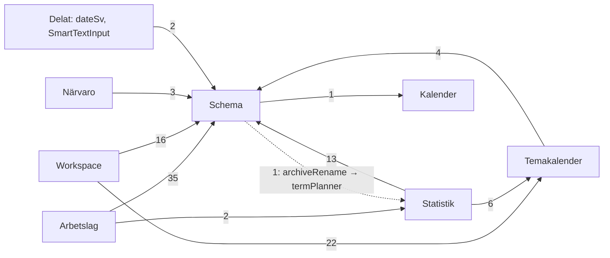

# Arkitekturgranskning: drive_c_frontend + drive_c_backend

Datum: 2026-11-09. Underlag: `main` i båda repona (frontend `db22dc7`, backend `c453d96`),
git-historik 2026-05-09 – 2026-11-09 (frontend 236 commits utan merge, backend 93).
Det här är en granskning. Ingen kod är ändrad och inget är committat.

**Läs detta först: uppdraget beskriver ett äldre läge.** Uppdraget säger att båda repona saknar
`CLAUDE.md`. Det stämmer inte längre. Samma granskning gjordes 2026-10-15
(`docs/architecture-review-2026-10-15.md` på grenen `ccr-8a25efe4-qgabb1`), och sedan dess finns
`CLAUDE.md` och CI i båda repona, och statusen för fynden förs i backendens
`docs/granskning-status.md`. Den här rapporten är därför en **uppföljning**: varje fynd från
oktober är prövat mot dagens kod, och det som tillkommit sedan dess har egna fynd (N1–N5).
Fynd-id:n F1–F21 är desamma som i oktober, så att raderna i `granskning-status.md` går att
uppdatera. Utkasten till `CLAUDE.md` är förslag till nya versioner av de filer som redan finns.

Kontrollerat vid granskningen: frontend `pnpm test` ger 1 269 gröna tester i 81 filer (514 i 36
filer i oktober), `tsc --noEmit` är rent och `pnpm lint` ger 1 varning (`WorkspaceShell.tsx:180`).
Backend `pytest` ger 535 gröna tester i 32 filer (301 i oktober) och 10 292 varningar på en
nyinstallerad miljö (SQLAlchemy 2.1.8, Flask 3.1.3, PyJWT 2.10.1). `alembic heads` visar en head,
`023_narvaro_document`.

---

## 1. Sammanfattning

1. Skyddsnätet är byggt: CI, `CLAUDE.md`, hooktester för alla sparvägar och en gemensam sparkö (`utils/saveQueue.ts`). Det som var farligast i oktober, osynliga fel vid sparning, är inte längre ett arkitekturproblem.
2. Det som kostar nu är **att varje ny feature kopierar i stället för att återanvända**. Närvaro (2026-11-04) kom med en fjärde kopia av `PayloadError`, en fjärde `readData`, två egna ISO-veckofunktioner och en komponent på 1 110 rader. Oktoberrapporten förutsåg just det, och de två små delade modulerna (`api/validation.py`, `services/http.ts`) är fortfarande inte skrivna.
3. De stora filerna växer i stället för att krympa: `LessonLab.tsx` 1 356 → 1 550 rader, `planner_routes.py` 1 222 → 1 445, `useArchiveManager.ts` 702 → 811, `workspace.css` 2 743 → 3 105. `NewSchedulePlanner.tsx` står still på 2 598.
4. Dokumenten har börjat glida igen: fyra planer säger "inte sammanslagen" om kod som ligger på `main`, och `granskning-status.md` är från 2026-10-24.
5. Börja med dokumenten, den mekaniska delningen av `LessonLab.tsx` och `api/validation.py`. Alla tre är under en timme och kräver inga nya tester.

---

## 2. Featurekarta och beroenden

### 2.1 Tabell

Antalet filer och rader gäller frontend och är räknat på sökväg och filnamn (tester och CSS ingår).

| Feature | Frontend: route → rot | Hooks / services / utils (urval) | Backend: blueprint → modeller | Tester |
|---|---|---|---|---|
| **Schema** (133 filer, 23 400 rader) | `/` och `/features/schedule` → `components/schedule/NewSchedulePlanner.tsx`; `/s/[token]` → `schedule/public/*`; `dev-planning-check` | `useArchiveManager`, `usePlannerSync`, `useHiddenSettings`, `useScheduleFolders`, `useDragHandlers`, `useScheduleKeyboardNav`, `useNotesMarquee`; `plannerService`, `publicScheduleService`; `utils/schedule*`, `planningTime`, `plannerBackup`, `bulkEditSchedule`, `schedulePdf/*`; `types/schedule.ts`; `config/plannerConstants.ts` | `planner_routes.py` (`/api/planner`, 23 routes), `planner_folder_routes.py` (`/api/planner/folders`) → `planner_models.py` | BE: 8 filer, god täckning. FE: utils och fyra hookar (`usePlannerSync`, `useArchiveManager`, `useHiddenSettings`, fixturerna). Inte NSP eller komponenterna |
| **Workspace** (84 filer, 16 650 rader) | `/workspace` → `app/workspace/_feature/` (per feature) | `useWorkspaceData`, `useWorkspaceSync`, `useWorkspaceHistory`, `useProvenance`; `workspaceService`, pdf- och bildproxy; `utils/mindmap*`; `workspace.css` | `workspace_routes.py`, `pdf_proxy_routes.py`, `image_proxy_routes.py` → `workspace_models.py`; `services/pdf_proxy.py`, `image_proxy.py` | BE: 9 filer. FE: skrivpipelinen, reducern, mindmap-utils. Inte `WorkspaceShell` eller editorerna |
| **Arbetslag** (33 filer, 8 400 rader) | `/features/arbetslag` (+`/detalj`) → `lesson-lab/LessonLab.tsx`, `LessonLabDetail.tsx` | `useLessonLabState`, `useLabArchive`; `arbetslagService`; `utils/lessonLab*`, `labPlanStore`, `labPlans`, `labExport`, `labScheduleExport` | `arbetslag_routes.py` → `arbetslag_models.py` | Båda repona, god täckning av logiken. Inte komponenterna |
| **Temakalender** (21 filer, 4 800 rader) | `/features/temakalender` → `theme-wheel/ThemeWheelPlanner.tsx` | `useThemeWheelSync`, `useThemeWheelExport`, `useWheelInteraction`; `themeWheelService`; `utils/themeWheel*` | `theme_routes.py` (`/api/theme`) → `theme_models.py` | BE: `test_theme_wheel`. FE: `useThemeWheelSync`, `themeWheelLayout` |
| **Närvaro** (ny 2026-11-04; 20 filer, 4 500 rader) | `/features/narvaro` → `narvaro/Narvaro.tsx` | `useNarvaroSync`; `narvaroService`; `utils/narvaro`, `narvaroDocs`, `narvaroCrypto`, `narvaroKeyStore`, `narvaroMobile` | `narvaro_routes.py` → `narvaro_models.py` (krypterade dokument med version) | BE: `test_narvaro`. FE: utils och `useNarvaroSync`. Inte komponenterna |
| **Kalender** (21 filer, 2 950 rader) | `/features/calendar` → `month-calendar/CalendarShell.tsx` | `useCalendarData`, `useCalendarAutosave`; `monthCalendarService`; `calendarDates`, `calendarSaveQueue`; `styles/month-calendar.css` | `month_calendar_routes.py` (`/api/calendar`) → `month_calendar_models.py` | BE: `test_month_calendar`. FE: datumlagret, kön, `useCalendarData` |
| **Statistik** (dold; 14 filer, 2 750 rader) | `/features/statistik` → `term-planner/TermPlanner.tsx` | `termService`; `utils/termPlanner.ts` | `term_routes.py` (`/api/terms`) → `term_models.py` | BE: `test_planner_term`. FE: `termPlanner.test` |
| **Bibliotek** (10 filer, 1 050 rader) | `/features/bibliotek` → `page.tsx` (250 rader, anropar API direkt) + `FileList/*` | `libraryTree`, `librarySync` | `routes.py` (`/api/files`, `/api/update`) → `DriveFile` i `services/db_config.py`; `services/drive_connect.py` | BE: drive-sync. FE: utils |
| **Trafik** (ny 2026-11-04; 7 filer, 560 rader) | `/features/trafik` → `traffic/TrafficDashboard.tsx` | `trafficService`; `utils/traffic` | `traffic_routes.py` (`/api/trafik`) → ingen modell; `services/access_log.py` | Båda repona |
| **Delat** | `RootLayoutBase`, `FeatureNavigation`, `ProtectedRoute`, `SessionExpiredDialog`, `components/ui/*` | `AuthContext`, `authService.fetchWithAuth`, `usePersistentState`, `useUndoableState`, `useMovableDialog`; `utils/saveQueue`, `saveRetry`, `leaveSave`, `keepalive`, `download`, `dateSv`; `styles/tokens.css` | `auth_routes.py`, `responses.py`, `services/db_retry.py`, `rate_limit.py` | `authService`, sparverktygen. BE: token, rate limit, retry |
| *Utan anropare* | – | – | `notes_routes.py` (387 rader), `/api/sections`, `/api/planner/courses*`; modeller för borttagna features (`calendar.py`, `schedule_models.py`, `command_center_models.py`) | – |

### 2.2 Beroenden mellan features (frontendimporter)

Antalet importrader står på pilarna. CSS-importer av `schedule-theme.css` (Kalender, Närvaro,
Trafik, Temakalender, Statistik, Workspace) är inte utritade.

**Nytt sedan oktober: en cykel mellan features.** `utils/archiveRename.ts:3` (Schema) importerar
`weekNumberFromName` från `utils/termPlanner.ts` (Statistik), som i sin tur importerar från Schema
på 13 ställen. Funktionen läser veckonumret ur ett schemanamn och hör hemma i Schema (se F18).
På filnivå finns två cykler: `HeadingToolbar.tsx ↔ editors/HeadingEditor.tsx` (sedan tidigare) och
`useHiddenSettings.ts ↔ utils/plannerBackup.ts` (ny; den ena riktningen är `import type`, så den
är ofarlig, men en fil i `utils/` hämtar sin typ ur `hooks/`).

**Schema är fortfarande appens delade kärna.** `types/schedule.ts` importeras från 73 ställen
(63 i oktober), `config/plannerConstants.ts` från 35 och `utils/scheduleTime.ts` från 29. Även
Närvaro, som inte har något med schemat att göra, hämtar `PLANNER_DAYS` och `autocomplete` därifrån.

---

## 3. Hotspots: de 20 filer som ändrats oftast

Commits utan merge 2026-05-09 – 2026-11-09 i båda repona. "Sedan 10-15" är hur många av dem som
kom efter förra granskningen. "Filer/commit" är medianen av hur många filer som ändrades i samma
commit. Tre filer delar plats 20 med 10 ändringar (`ThemeWheelPlanner.tsx`, `TermPlanner.tsx`,
`PublicDayList.tsx`); `usePlannerSync.ts` står med eftersom den ändrats senast.

| # | Repo | Fil | Ändr. | Sedan 10-15 | Rader (10-15 → nu) | Filer/commit | Tester | Bedömning |
|---|---|---|---|---|---|---|---|---|
| 1 | FE | `components/schedule/NewSchedulePlanner.tsx` | 52 | 8 | 2 622 → 2 598 | 8 | inga egna; hookarna runt den testade | Står still i storlek. Se F13 |
| 2 | FE | `components/lesson-lab/LessonLab.tsx` | 31 | 5 | 1 356 → 1 550 | 4 | inga (utils testade) | Växer snabbast. Se F9 |
| 3 | FE | `workspace/_feature/styles/workspace.css` | 24 | 4 | 2 743 → 3 105 | 6,5 | – | Se F8 |
| 4 | FE | `workspace/_feature/hooks/useWorkspaceData.ts` | 22 | 3 | 1 273 → 1 319 | 6 | **ja**, skrivpipelinen (10 fall) | Se F15 |
| 5 | FE | `components/FeatureNavigation.tsx` | 20 | 3 | 218 → 240 | 9 | inga | Ändras för varje ny sida. Se F19 |
| 6 | BE | `api/planner_routes.py` | 18 | 6 | 1 222 → 1 445 | 3,5 | god (8 filer) | Växer. Se F16 |
| 7 | FE | `workspace/_feature/components/WorkspaceShell.tsx` | 17 | 1 | 965 → 972 | 9 | inga | Lugn sedan oktober. Se F15 |
| 8 | BE | `app.py` | 16 | 4 | 196 → 207 | 7 | **körs aldrig i test** | Varje ny blueprint och modell. Se F4 |
| 9 | FE | `services/plannerService.ts` | 14 | 5 | – → 412 | 10 | ja (106 rader) | Egen `unwrap`. Se F14 |
| 10 | FE | `types/schedule.ts` | 13 | 2 | 178 → 198 | 11 | – | Delad kärna, 73 importörer |
| 11 | FE | `hooks/useHiddenSettings.ts` | 13 | 1 | 193 → 216 | 10 | **ja** (import av backup) | F10 till stor del löst |
| 12 | FE | `workspace/_feature/components/CanvasElement.tsx` | 13 | 3 | 373 → 377 | 8 | inga | Typspecifika grenar. Se F11 |
| 13 | FE | `components/schedule/public/PublicScheduleView.tsx` | 12 | 2 | 334 → 432 | 3 | inga (filter och cache testade) | OK |
| 14 | FE | `components/schedule/ScheduledEventCard.tsx` | 12 | 0 | 209 | 10,5 | inga | OK |
| 15 | FE | `app/globals.css` | 12 | 0 | 289 | 9 | – | OK |
| 16 | BE | `api/workspace_routes.py` | 12 | 2 | 662 → 696 | 3 | god (9 filer) | OK |
| 17 | FE | `hooks/useArchiveManager.ts` | 11 | 3 | 702 → 811 | 11 | **ja** (schemabyte och uppstart, 5 fall) | Växer. Se F17 |
| 18 | FE | `config/shortcuts.ts` | 11 | 1 | 77 → 86 | 11 | – | Se F19 |
| 19 | FE | `workspace/_feature/types/constants.ts` | 11 | 0 | 230 | 14 | – | Ingen ny elementtyp sedan augusti. Se F11 |
| 20 | FE | `hooks/usePlannerSync.ts` | 10 | 3 | – → 549 | 12,5 | **ja** (545 rader) | OK, väl skyddad |

**Utanför listan men värd att bevaka:** `components/narvaro/Narvaro.tsx` har 1 110 rader efter 6
commits på fem dagar (2026-11-04 – 11-09) och är appens tredje största komponent. Se N1.

Jämfört med oktober har fyra av hotspotsen fått tester (`useWorkspaceData`, `useHiddenSettings`,
`useArchiveManager`, `usePlannerSync`). Helt otestade bland de 20 är NSP, `LessonLab`,
`FeatureNavigation`, `WorkspaceShell`, `CanvasElement` och `app.py`.

---

## 4. Fyndtabell

**Påverkan:** H = kostar tid eller orsakar fel varje månad, M = några gånger per kvartal, L = sällan.
**Insats:** S = under en timme, M = under en dag, L = mer än en dag.
Sorterad på kvoten påverkan delat med insats (H=3, M=2, L=1 och S=1, M=2, L=3). Klara fynd från
oktober (F1, F2, F3) står inte med; se `granskning-status.md`.

| ID | Påv. | Insats | Kvot | Repo | Plats | Rubrik | Jämfört med oktober |
|---|---|---|---|---|---|---|---|
| F9 | H | S | 3 | FE | `LessonLab.tsx:674–1550` | Fjorton subkomponenter inline i den fil som växer snabbast | Värre: +194 rader, +1 komponent |
| N2 | M | S | 2 | båda | `docs/plans/*.md`, `granskning-status.md`, `DEPLOY.md:36` | Statusrader som blir fel i samma stund som PR:en slås ihop | Nytt (F2 i ny form) |
| N3 | M | S | 2 | båda | båda `CLAUDE.md` | `CLAUDE.md` saknar Närvaro, Trafik, sparkön och fyra fällor | Nytt |
| F7 | M | S | 2 | BE | `theme_routes.py:59`, `term_routes.py:43`, `arbetslag_routes.py:58`, `narvaro_routes.py:45` | `PayloadError` och valideringshjälpare kopierade mellan routes | Värre: 3 → 4 kopior |
| F5 | M | S | 2 | BE | `requirements.txt`, `services/db_config.py:17`, rotskript | Ospärrade beroenden, 10 292 varningar och kvarliggande engångsskript | Delvis åtgärdat |
| F18 | M | S | 2 | FE | `termPlanner.ts:205`, `useArchiveManager.ts:53`, `narvaro.ts:233`, `narvaroDocs.ts:52`, `dateSv.ts:30` | Veckonummer räknas och tolkas på fem ställen, och ger en cykel mellan Schema och Statistik | Värre: var L |
| N1 | H | M | 1,5 | FE | `components/narvaro/Narvaro.tsx` | 1 110 rader, 33 `useState` och 650 rader JSX i den feature som ändras mest just nu | Nytt |
| F14 | M | M | 1 | FE | `src/services/*.ts`, `_feature/services/*` | Sju varianter av svarshantering | Värre: +2 (`narvaroService`, `trafficService`) |
| F16 | M | M | 1 | BE | `planner_routes.py`, `planner_folder_routes.py:20` | Tre delområden i 1 445 rader, och den utbrutna filen importerar privata hjälpare | Värre |
| F12 | M | M | 1 | båda | services ↔ serializers | API-kontraktet kontrolleras inte av något | Regeln finns, inget test |
| F13 | H | L | 1 | FE | `NewSchedulePlanner.tsx` | Gudkomponent på 2 598 rader | Oförändrad, men skyddsnätet finns nu |
| F15 | M | M | 1 | FE | `useWorkspaceData.ts:426–839`, `WorkspaceShell.tsx:555–730` | Elementåtgärder och menybygge i två filer | Skrivpipelinen testad |
| F17 | M | M | 1 | FE | `useArchiveManager.ts` | Sex ansvarsområden i en hook, behöver `saveNowRef` | Värre: +109 rader |
| F4 | L | S | 1 | BE | `app.py:166–198`, `tests/conftest.py:18`, `migrations/env.py:11` | Modellerna registreras på tre ställen; `app.py` körs aldrig i test | Head-kontroll i CI |
| F19 | L | S | 1 | FE | `FeatureNavigation.tsx:37`, `config/shortcuts.ts:14` | Featurelistan och genvägshjälpen i två kopior | Oförändrad |
| F20 | L | S | 1 | FE | 26 filer med `localStorage` direkt | localStorage-nycklarna är utspridda | Regeln finns i `CLAUDE.md` |
| F6 | L | S | 1 | FE | `TermPlanner.tsx:146–174`, 8 statustyper | Statistik sparar fortfarande med en egen timer | Till största delen löst |
| F8 | L | S | 1 | FE | `workspace.css`, `kron:` | `kron:` (297 användningar) och Tailwind-grått utanför workspace saknar regel | Regeln för tokens finns |
| F10 | L | M | 0,5 | FE | `useHiddenSettings.ts`, `HiddenSettingsDialog.tsx` | En ny inställning rör fortfarande fem filer | Backupen löst (typfel vaktar) |
| F11 | L | M | 0,5 | FE+BE | `useWorkspaceData.ts`, `ElementRenderer.tsx`, `constants.ts`, `workspace_models.py:69` | En ny elementtyp rör 14–16 filer | Ingen ny typ sedan 2026-08-10 |
| F21 | L | L | 0,33 | FE | `src/` | Två organisationsmönster | Oförändrad; rekommendationen står kvar |

---

## 5. Fynden i detalj

### F9 – Fjorton subkomponenter inline i `LessonLab.tsx` (H/S, FE)

**Problem.** Filen har 1 550 rader. Huvudkomponenten är rad 184–673. Resten är fjorton
subkomponenter: `Schedule` (`:674`), `DayColumn`, `LessonBox`, `ReserveMark`, `StaffingLine`,
`ClassGroupBox`, `ClassPart`, `Teams` (`:1098`), `TeacherChip`, `LoadChip` (ny, `:1263`),
`TeamCard`, `Brick`, `NewTeamCard` och `DragPreview` (`:1534`). Logiken ligger redan i testade
utils. Mappen har redan nio andra `Lab*.tsx`-filer, så mönstret finns.

**Vad blir dyrare.** Filen har ändrats 31 gånger på sex månader, och fynd F9 har stått öppet medan
den växte med 194 rader på tre veckor: `3323b55` (lärarraden som brickor, +144/−83), `a2c952a`
(tjänstgöringsgrad, +58) och `9555fcf` (export, +113). Varje sådan ändring läser hela filen, och två
sessioner samtidigt krockar. `DayColumn` finns dessutom som namn i `components/schedule/`.

**Förslag.** Flytta mekaniskt, utan beteendeändring: `LabSchedule.tsx` (rad 674–1097),
`LabTeams.tsx` (rad 1098–1533) och `LabDragPreview.tsx`. Döp `DayColumn` till `LabDayColumn`.

**Första steget.** En PR som bara flyttar. `tsc` och bygget räcker som skyddsnät.

### N2 – Statusrader som blir fel när PR:en slås ihop (M/S, båda)

**Problem.**
- Fyra planer säger "inte sammanslagen" om kod som ligger på `main`: `schemamappar.md:3`,
  `mindmap-tangentbord.md` (i indexet), `narvaro-passnamn.md:3` och `narvaro-mobillage.md:3`
  (sammanslagen i `db22dc7`, #261, samma dag). Orsaken är strukturell: statusen skrivs i den PR
  som sedan slås ihop, så den är fel från den stunden. Oktoberrapporten hittade samma sak i fem
  av sex planer, och det rättades för hand i FE #231.
- `granskning-status.md` säger "Senast uppdaterad 2026-10-24". Den anger FE #247 och BE #52 som
  "(öppen)"; båda är sammanslagna. F16 anger "omkring 1 450 rader" (stämmer), F9 och F17 saknar
  kommentar fast filerna vuxit.
- De tre granskningsrapporterna ligger på sessionsgrenar (`ccr-8a25efe4-qgabb1` med flera), inte på
  `main`. En session som ska åtgärda ett fynd måste hämta en gren för att läsa det.
- `DEPLOY.md:36` säger att ingen virtualenv behöver aktiveras på PythonAnywhere. `CLAUDE.md` säger
  att webbappen kör i virtualenv `myenv310` och att systemets Python har en annan PyJWT. Båda kan
  vara sanna (konsolen för alembic, virtualenv för appen), men ingen av filerna säger det.

**Vad blir dyrare.** En session som läser "inte sammanslagen" letar efter en gren eller tror att
koden saknas på `main`. `pip install` enligt `DEPLOY.md` i konsolen hamnar utanför den virtualenv
som appen kör i.

**Förslag.** Ändra regeln i `docs/plans/README.md` så att statusraden aldrig nämner sammanslagning:
`Status: Genomförd 2026-11-09 (#261)`. PR-numret säger resten. Rätta de fyra raderna och indexet.
Uppdatera `granskning-status.md` med tabellen i avsnitt 4. Lägg arkitekturrapporterna på `main`
under `docs/arkiv/` (säkerhetsrapporten ska förbli privat). Skriv i `DEPLOY.md` vilken Python som
kör vad.

### N3 – `CLAUDE.md` har luckor för det som kommit sedan oktober (M/S, båda)

**Problem.** Filerna är bra och i huvudsak aktuella. Det som saknas eller är fel:
- Närvaro och Trafik nämns inte, varken i inledningen eller under sparning och nyckelstil. Närvaro
  har egna regler som inte syns någon annanstans: allt krypteras i webbläsaren, servern ser bara
  chiffertext, veckor äldre än 365 dagar gallras.
- Sparavsnittet nämner inte `utils/saveQueue.ts`, som Temakalender, Workspace och Närvaro numera
  delar, och säger att Workspace gör "ett anrop per ändring" utan att nämna kön.
- Regeln att en ny service kopierar `unwrap` i `workspaceService.ts` leder till fler kopior (F14).
- Backendens fil säger inget om `PayloadError` eller om att `app.py` inte körs i test.
- Ingen av filerna säger var granskningsrapporterna ligger eller att planernas status glider (N2).
- `kron:` och Tailwind-grått (F8) har ingen regel.

**Förslag.** Utkasten `docs/CLAUDE.frontend.draft.md` och `docs/CLAUDE.backend.draft.md` är hela
filer som kan ersätta dagens. De har 60 och 55 rader med en punkt per rad (dagens har 114 och 97 med radbrytningar) och beskriver läget
2026-11-09.

### F7 – `PayloadError` och valideringshjälpare kopierade mellan routes (M/S, BE)

**Problem.** `PayloadError` finns nu i fyra kopior (`theme_routes.py:59`, `term_routes.py:43`,
`arbetslag_routes.py:58`, `narvaro_routes.py:45`) och fångas med egen `try/except` på tio ställen.
`_text` och `_integer` finns i två varianter (theme har `default=`, term har inte). `_is_int` och
`_conflict` finns i både arbetslag och närvaro, `_client_id` och `_usernames_for` i både planner
och arbetslag. `planner_routes` använder i stället `ValueError` (`:603`).

**Vad blir dyrare.** Nästa route. Oktoberrapporten skrev att nästa route skulle kopiera, och
`narvaro_routes.py` (2026-11-04) gjorde det. Backend har fått tre nya routes-filer på tre veckor.

**Förslag.** `api/validation.py` på omkring 60 rader: `PayloadError`, `text()`, `integer()`,
`color()`, `client_id()`, `is_int()`. Registrera `errorhandler(PayloadError)` i `create_app` och i
`tests/conftest.py`, som svarar 400 via `error_response`. Flytta `usernames_for` till
`models/user.py`. Låt `_has_access` och `_conflict` ligga kvar per feature; de arbetar mot olika
tabeller, och en generisk delningstjänst vore ett ramverk.

**Första steget.** Skapa filen och flytta `narvaro_routes` och `term_routes` (de minsta). Testerna
för felaktig indata finns redan i `test_narvaro.py` och `test_planner_term.py`.

### F5 – Ospärrade beroenden, varningar och kvarliggande skript (M/S, BE)

**Läge.** `lib/jwt` och skräpfilerna är borta, och PyJWT är spärrad till 2.10.1. Kvar:
- `requirements.txt` spärrar bara PyJWT, alembic (`<2`) och python-dotenv. En nyinstallation i dag
  ger SQLAlchemy 2.1.8 (2.1.4 i oktober) och Flask 3.1.3. Vilka versioner `myenv310` har framgår
  inte av repot.
- Testkörningen ger 10 292 varningar (5 758 i oktober). De flesta kommer från
  `services/db_config.py:17`, där `ping_connection(connection, branch)` har en signatur som
  SQLAlchemy har aviserat ska bort, och från `datetime.utcnow()` på 60 ställen.
- `bcrypt` står i `requirements.txt` men importeras ingenstans.
- Fem engångsskript och `drive_contents.json` ligger kvar i roten (avsnitt 6).

**Vad blir dyrare.** En ominstallation av virtualenv på PythonAnywhere, eller nästa CI-körning
efter en SQLAlchemy-release som tar bort den gamla signaturen: då faller varje test på en gång,
utan att någon ändrat koden.

**Förslag.** Kör `pip freeze` i `myenv310` och spärra de sex direkta beroendena med `==`. Byt
`ping_connection` mot `pool_pre_ping=True` i `SQLALCHEMY_ENGINE_OPTIONS`, eller ge den nya
signaturen. Ta bort `bcrypt`. `utcnow` kan vänta; det är en Python-varning utan utsatt datum.

### F18 – Veckonummer räknas och tolkas på fem ställen (M/S, FE)

**Problem.** Två olika saker har var sin dubblering:
- *Veckonummer ur ett schemanamn:* `termPlanner.ts:205` (`weekNumberFromName`, tål "Vecka 35" och
  "v. 35") och `useArchiveManager.ts:53` (`/^v\.?\s*(\d+)$/i`, tål bara "v35"). Arkivlistan sorterar
  därför "Vecka 35" som text medan Statistik och namnbytet (`archiveRename.ts:47`) ser en vecka.
- *ISO-vecka ur ett datum:* `dateSv.ts:30` (`isoWeekYear`, den gemensamma), `narvaro.ts:233`
  (`isoWeek`) och `narvaroDocs.ts:52` (`isoWeekKey`). De två i Närvaro är egna implementationer av
  samma räkning, skrivna 2026-11-04.

Eftersom `weekNumberFromName` ligger i Statistik fick Schema en import därifrån (`archiveRename.ts:3`),
vilket är cykeln i avsnitt 2.2.

**Vad blir dyrare.** Varje ändring av hur veckor namnges eller räknas, till exempel läsår som går
över årsskiftet. Närvarons veckonyckel (`w2026-45`) måste dessutom stämma med backendens
`date.fromisocalendar` (`narvaro_routes.py:71`); med tre implementationer i frontend är det tre
ställen som kan avvika.

**Förslag.** Flytta `weekNumberFromName` till `utils/scheduleKind.ts` (eller en ny
`utils/scheduleWeek.ts`) och låt `termPlanner` importera den därifrån; cykeln försvinner. Låt
`sortArchives` använda den (det ändrar sorteringen för namn som "Vecka 35"; skriv det i PR:en).
Låt `narvaro.isoWeek` och `narvaroDocs.isoWeekKey` anropa `isoWeekYear`. Testerna finns
(`termPlanner.test`, `narvaroDocs.test`, `dateSv.test`).

### N1 – `Narvaro.tsx` byggdes som en enda komponent (H/M, FE)

**Problem.** `Narvaro.tsx` har 1 110 rader: 33 `useState`, en inklistringshanterare på 95 rader
(`handlePaste`, `:300–394`) och 650 rader JSX (`:395–1043`). Logiken runt den är däremot väl
uppdelad och testad (`utils/narvaro.ts`, `narvaroDocs`, `narvaroCrypto`, `useNarvaroSync`). Featuren
har också en egen `SaveIndicator` (`:1053`), fast workspace har en (`_feature/components/SaveIndicator.tsx`).

**Vad blir dyrare.** Närvaro är det som ändras just nu: 7 av de 15 senaste commitsen i frontend
(passnamn, namnifyllnad, mobilläge). Filen är på väg samma väg som `LessonLab.tsx`, och det är
billigast att dela den innan den har vuxit.

**Förslag.** Två steg:
1. Lyft ut tolkningen av det inklistrade ur `handlePaste` till en ren funktion i `utils/narvaro.ts`
   med tester, så att komponenten bara lägger resultatet i state.
2. Dela JSX:en efter skärmens delar (verktygsrad, tabell, gruppindelning, klassväljare). Mönstret
   finns redan i `NarvaroGroups.tsx` och `NarvaroMobile.tsx`.

**Första steget.** Steg 1, eftersom det ger ett test i samma PR.

### F14 – Sju varianter av svarshantering (M/M, FE)

**Problem.**
- `readData<T>(response, fallback)` finns fyra gånger: `arbetslagService.ts:23`,
  `narvaroService.ts:23`, `termService.ts:8` och `themeWheelService.ts:20`.
- `async unwrap<T>(res)` finns två gånger: `monthCalendarService.ts:56` och `workspaceService.ts:24`.
- `plannerService.ts:57` har en egen `unwrap(payload: any)` med `response.ok`-kontroller per metod.
- `trafficService.ts:23` packar upp för hand. `bibliotek/page.tsx` anropar `fetchWithAuth` direkt.

`CLAUDE.md` säger "packa upp som `unwrap` i `workspaceService.ts` gör", och det tolkas som
"kopiera den". Två nya services på tre veckor gav två nya varianter.

**Vad blir dyrare.** Varje ny endpoint, och varje ändring av felhanteringen. När 401 fick en
inloggningsruta (FE #236) gick det bra för att allt passerar `fetchWithAuth`; en motsvarande
ändring för 409 eller 413 måste i dag göras på sju ställen.

**Förslag.** `src/services/http.ts` med `readData<T>(response, fallbackMessage)` och en `ApiError`
med `status`. Specialfelen (`ArchiveConflictError`, `PlanConflictError`, `NarvaroConflictError`,
`TrafficNotAvailableError`) mappas från `status` i respektive service. Bygg inte en klient med
metoder; `fetchWithAuth` plus en uppackare räcker.

**Första steget.** `http.ts` med `http.test.ts` (ok, `success: false`, ogiltig JSON, 409) och flytta
`termService` och `narvaroService`. De övriga flyttas när de ändras ändå.

### F16 – `planner_routes.py` växer, och den utbrutna filen importerar privata hjälpare (M/M, BE)

**Problem.** Filen har 1 445 rader (1 222 i oktober) och är backendens mest ändrade (18 ändringar,
6 sedan oktober). Tre delområden: arkiv med aktiviteter, lås, version och delning (`:70–1019`),
publika länkar (`:1020–1396`) och kurser (`:1397–`, utan anropare i frontend). Mapparna bröts ut
till `planner_folder_routes.py`, vars docstring säger att `planner_routes.py` "redan är för stor".
Men den nya filen importerar `_folder_name` och `_serialize_archives` därifrån
(`planner_folder_routes.py:20`), alltså privata namn ur en annan routes-fil. Att radera ett arkiv
(mjukradera aktiviteterna, ta bort delningarna, ta bort raden) görs fortfarande på två ställen:
`delete_planner_activities:616` och `delete_shared_archive:795`. Modellerna har inga relationer,
eftersom FK:er medvetet saknas (MySQL-fel 3780), så all kaskadlogik ligger i routes.

**Vad blir dyrare.** Nästa tabell som hänger på ett arkiv: båda raderingsvägarna, och mapparnas
serialisering, måste ändras. Nästa utbrutna fil importerar fler privata namn.

**Förslag.** Tre PR:er, ingen repository- eller tjänsteklass-arkitektur:
1. Flytta arkivhjälparna (`_has_access`, `_load_archive`, `_lock_holder`, `_claim_lock`,
   `_clear_lock`, `_claim_version`, `_bump_version`, `_serialize_archives`, `_archive_name`,
   `_folder_name`) till `services/planner_archives.py` med publika namn, plus en
   `delete_archive(archive)` som båda raderingsvägarna anropar.
2. Flytta `--- Publika länkar ---` (omkring 380 rader) till `api/planner_public_routes.py`.
3. Ta bort `/courses*` när det är bekräftat i access-loggen att inget anropar dem (trafiksidan
   kan numera visa det).

Lagerregeln för hela backend blir då: **routes** läser indata, kontrollerar ägare och svarar;
**`api/validation.py`** tolkar indata; **`services/<feature>.py`** finns bara för det som två
routes-filer delar eller som måste hållas ihop (kaskader); **modellen** har `to_dict`. De andra
routes-filerna (theme 683, workspace 696) behöver inget tjänstelager i dag.

### F12 – API-kontraktet kontrolleras inte av något (M/M, båda)

**Läge.** Nyckelstilen per feature står i båda `CLAUDE.md`, och typerna som speglar backend är
utpekade. Inget test kontrollerar formen. Frontendens services omvandlar fortfarande svaret utan
kontroll (`as T` på 7 ställen), med två undantag som är värda att följa: `narvaroService.ts`
(`isDocument`) och `arbetslagService.ts` (`parseLabState`) tvättar det som kommer in.
`DEPLOY.md` beskriver nu för varje migration vad som händer med ny frontend mot gammal backend,
vilket är den del av kontraktet som oftast gått fel.

**Alternativ, vägda mot varandra:**

| Alternativ | Insats | Fångar | Bedömning |
|---|---|---|---|
| A. Regel och tabell i `CLAUDE.md` | S | inget automatiskt | **Gjort** |
| B. Formtest i backend: `assert set(data.keys()) == {...}` för de sex viktigaste svaren | S–M | att backend byter namn på eller tar bort ett fält | **Gör nu** |
| C. Golden files: backendtesterna skriver `tests/contract/*.json`, som kopieras till frontend och kontrolleras med `satisfies` | M | glidning åt båda håll, när filerna synkas | Bara om en glidning gått igenom trots B |
| D. OpenAPI och genererade typer | L | allt | För tungt för en Flask-app utan schemabibliotek och en utvecklare |

**Förslag.** B: en fil `tests/test_response_shapes.py` med ett fall per svar för `/planner/archives`,
`/planner/archives/<id>/activities`, `/workspace/surfaces/<id>/elements`, `/arbetslag/<id>`,
`/theme/wheels/<id>` och `/narvaro`. När ett sådant test faller står det i felmeddelandet vilken
frontendtyp som ska ändras. Det kostar en fil och fångar den vanligaste glidningen.

### F13 – `NewSchedulePlanner.tsx` (H/L, FE)

**Läge.** 2 598 rader, 52 ändringar på sex månader, 8 sedan oktober. Storleken står still, vilket
betyder att nya saker numera läggs utanför (`useScheduleFolders`, `plannerBackup`, `leaveSave`).
Rad 182–1486 är logik och rad 1487–2561 JSX. `isReadOnlyRef` (`:191`) och `saveNowRef` (`:297`)
håller fortfarande ihop hookordningen.

**Det som ändrats i förutsättningarna.** I oktober fanns inga hooktester. Nu är `usePlannerSync`,
`useArchiveManager` och `useHiddenSettings` testade med jsdom och egen `renderHook`, så logiken
går att lyfta ut bakom tester utan ny konfiguration. Det enda som saknas är ett test av
`commitSchedule`-spärren (`:389–398`), som ligger inline i komponenten.

**Ansvarsområden och föreslagen plats (radnummer i dagens fil):**

| Ansvar | Rader | Föreslagen plats |
|---|---|---|
| Läsläge och `commitSchedule` | 186–398 | `useScheduleDocument` (äger schemat, ångra, läsläge och `commitSchedule`) |
| Export och uteslutning | 515–632 | `useScheduleExportActions` |
| Anteckningar till flera poster, urklipp | 640–785 | `useNotesClipboard` |
| Statistik per dag och kategori | 786–889 | `useScheduleStatsView` (rena funktioner finns i `scheduleStats`) |
| JSON-import och -export | 890–991 | resten in i `utils/plannerBackup.ts` |
| Sök och ersätt | 992–1055 | `useFindReplace` |
| Massredigering | 1124–1272 | `useBulkSelection` |
| Verktygsfält och filter | 1509–2172 (660 rader) | `PlannerToolbar.tsx` |
| Arkivpanel | 2173–2237 | `ArchiveSidebar.tsx` |
| Kontextmeny | 2294–2439 | `PlannerContextMenu.tsx` |
| Modaler | 2440–2560 | `PlannerModals.tsx` |

**Förslag.** Samma ordning som i oktober: JSX-regionerna först (bara props, ingen logik), sedan
hookarna, sist `useScheduleDocument` med ett hooktest av spärren i alla fyra `readOnlyReason`.
Börja med verktygsfältet; det är en fjärdedel av filen.

### F15 – `useWorkspaceData.ts` och `WorkspaceShell.tsx` (M/M, FE)

**Läge.** `useWorkspaceData.ts` har 1 319 rader och är nu sektionerad med rubriker: Vy (`:159`),
Ytor (`:203`), Biblioteket (`:367`), Element (`:426`), Geometri (`:839`), Lås och förråd (`:969`),
Radering (`:1006`), Spegla och kopiera (`:1088`), Ångra (`:1206`). Skrivpipelinen går genom
`saveQueue` och har tio tester. `WorkspaceShell.tsx` (972 rader) bygger fortfarande kontextmenyn
inline (`:555–730`) och har ändrats en gång sedan oktober.

**Vad blir dyrare.** Nya importkällor och kortåtgärder hamnar i sektionen Element (413 rader, den
största) och i menybygget.

**Förslag.** Sektionerna är redan gränserna. Lyft ut en i taget till en hook som tar skrivaren som
argument, med början i Element (importer av hjul och schemadagar, "uppdatera från källan"). Lyft
ut menyn till en ren funktion `buildElementMenu(element, placement, ctx)` med test. Det är inte
bråttom: workspace har haft tre ändringar i `useWorkspaceData` på tre veckor.

### F17 – `useArchiveManager.ts` (M/M, FE)

**Läge.** 811 rader (702 i oktober) och sex sektioner: uppstart (`:188`), härledd vy (`:270`),
öppna, låsa och lämna (`:318`), skapa, duplicera och radera med dialogstate (`:458`), byta sort
(`:622`), byta namn (`:663`) och delning (`:689`). `saveNowRef` används på tre ställen. Fem tester
täcker schemabyte och uppstart.

**Förslag.** Lyft ut `useNewScheduleDialog` (`:458–621`, åtta `useState` och legacy-hämtningen) och
delningsdialogens state (`:689–`). Det som blir kvar är listan och låset, som hör ihop. Gör det i
samband med `useScheduleDocument` (F13), som tar bort behovet av `saveNowRef`.

### F4 – Modellerna registreras på tre ställen (L/S, BE)

**Läge.** CI kräver en alembic-head, och regeln står i `CLAUDE.md`. `narvaro_models` kom in rätt
på alla tre ställen. Påverkan är därför sänkt till L. Kvar: `app.py` (16 ändringar, plats 8 bland
hotspots) körs aldrig i test, eftersom `tests/conftest.py` bygger en egen app. En blueprint som
glöms i `app.py` ger gröna tester och 404 i produktion.

**Förslag.** `tests/test_app_factory.py`: importera `app` med en SQLite-URL och kontrollera att
varje prefix i en lista finns i `app.url_map`. Testet behövs också före F7, som lägger en
`errorhandler` i `create_app`. Ett `models/__init__.py` är fortfarande rimligt men inte brådskande.

### F19, F20, F6, F8 – små fynd där regeln finns men koden inte följt med (L/S, FE)

- **F19.** `FeatureNavigation.tsx:37` och `config/shortcuts.ts:14` har var sin lista. Närvaro och
  Trafik lades bara i den första, vilket är rätt eftersom de saknar siffergenväg. Flytta listan
  till `config/features.ts` nästa gång en sida med genväg tillkommer.
- **F20.** 26 filer rör `localStorage` direkt (17 i oktober), 13 använder `usePersistentState`.
  Regeln om versionerade nycklar och migrering står i `CLAUDE.md` och följdes av Närvaro
  (`LEGACY_KEYS` i `useNarvaroSync.ts`). Ingen åtgärd utöver regeln.
- **F6.** Sparmodellerna har konvergerat: `saveQueue` (Temakalender, Workspace, Närvaro),
  `labPlanStore` (Arbetslag), `calendarSaveQueue` (Kalender) och `usePlannerSync` (Schema), alla
  med tester och med tömning vid stängning. Skillnaderna är verkliga och ska inte slås ihop.
  Undantaget är `TermPlanner.tsx:146–174`, som sparar med en egen timer och bara varnar med
  `beforeunload`. Flytta den till `saveQueue` nästa gång Statistik ändras. Statustypen finns i
  åtta varianter; fyra av dem är identiska (`'idle' | 'saving' | 'saved' | 'error'`) och kan
  importera en gemensam när filerna ändras ändå.
- **F8.** Tokenregeln står i `CLAUDE.md` och följs i workspace (inget Tailwind-grått i
  `_feature/`). Utanför workspace finns Tailwind-grått kvar (`LessonLab.tsx` 15 ställen,
  `LabBoard.tsx` 14, NSP 11) och `kron:` används 297 gånger utan att någon regel säger när.
  Förslag: en rad i `CLAUDE.md` (finns i utkastet). `workspace.css` har 3 105 rader och 44
  sektionsrubriker; dela den per editor först om parallella grenar börjar krocka där.

### F10, F11 – registren som inte behövs än (L/M)

- **F10.** JSON-backupen vaktas nu av ett typfel (`plannerBackup.ts:30`, `satisfies Record<keyof
  HiddenSettingsDraft, true>`) och av tester. En ny inställning rör fortfarande nyckel, hook,
  sanerare, dialog och NSP, men ingen har tillkommit sedan 2026-10-13. Vänta med registret.
- **F11.** Ingen ny elementtyp sedan `heading` (2026-08-10). `ElementType`
  (`workspace.types.ts:2`) och `VALID_TYPES` (`workspace_models.py:69`) har samma 13 typer, och
  checklistan står i båda `CLAUDE.md`. Bygg `elementTypes.ts` i samma PR som nästa typ, inte före.

### F21 – Två organisationsmönster i `src/` (L/L, FE)

**Rekommendation: flytta inte, och låt den platta strukturen gälla för nya features.**
- Den platta strukturen fungerar för att namnen bär featuren: Närvaro kom in som
  `components/narvaro/`, `useNarvaroSync`, `narvaroService` och `utils/narvaro*.ts`, och gick att
  hitta med en sökning på `narvaro`.
- En flytt till `src/features/<x>/` skulle röra omkring 300 filer och bryta varje öppen gren.
  Frontend har 220 fjärrgrenar.
- Flytten löser inte det som gör ändringar dyra. Den delade kärnan (`types/schedule.ts`,
  `plannerConstants`, `scheduleTime`) hör inte till någon enskild feature, och de stora filerna
  blir inte mindre av att byta mapp.
- Workspace får vara kvar under `_feature/`. Den är självständig och importeras inte av någon
  annan feature.

`src/types/` och `_feature/types/` överlappar inte: de förra är API- och domäntyper för de platta
featurerna, de senare bara workspace. Den enda oklarheten är att `_feature/types/constants.ts` och
`types/utils.ts` inte är typer; flytta dem i samband med F11.

### De stora filerna i sammandrag

| Fil | Rader | Ansvarsområden | Uppdelning | Fynd |
|---|---|---|---|---|
| `NewSchedulePlanner.tsx` | 2 598 | dokument och läsläge, export, anteckningar, statistik, backup, sök/ersätt, massredigering, fyra JSX-regioner | tabellen i F13 | F13 |
| `LessonLab.tsx` | 1 550 | huvudvy och 14 subkomponenter | `LabSchedule`, `LabTeams`, `LabDragPreview` | F9 |
| `useWorkspaceData.ts` | 1 319 | nio rubricerade sektioner | en hook per sektion, Element först | F15 |
| `Narvaro.tsx` | 1 110 | inklistring, urval, grupper, mobilläge, 650 rader JSX | ren inklistringsfunktion, sedan JSX-delar | N1 |
| `WorkspaceShell.tsx` | 972 | kontextmeny, urklipp, gruppdragning, layout | `buildElementMenu`, `useWorkspaceClipboard` | F15 |
| `useArchiveManager.ts` | 811 | sex sektioner | `useNewScheduleDialog`, delningsstate | F17 |
| `ThemeWheelPlanner.tsx` | 687 | block, bibliotek, lovveckor, tangentbord, rendering | redan sektionerad och med hookarna utlyfta; en ändring sedan oktober. Lämna den | – |

### Grupper som inte bör bli gemensamma abstraktioner

- **Sync och autosave:** se F6. Fyra motorer för fyra datamodeller, alla testade. Rör dem inte.
- **Drag** (`useDragHandlers` med dnd-kit, `useDragSort` med HTML5, `useElementDrag` med
  pekarhändelser): tre tekniker för tre interaktioner. Den enda städningen är `event: any` i
  `useDragHandlers.ts` (7 av frontendens 10 `any`).
- **Ångra** (`useUndoableState` med `utils/undoHistory`, `useWorkspaceHistory` med
  `utils/undoStack`, `mindmapHistory`): redan rena och testade var för sig.
- **Export:** delar `utils/download.ts`. NSP:s JSON-export går numera via `downloadBlob`.
- **State:** två contexts (`AuthContext`, `WorkspaceContext`) och i övrigt stora hookar som
  lämnar ett objekt till en rotkomponent (`WorkspaceShell.tsx:56–100` plockar ut ett fyrtiotal
  fält). Det är prop drilling i ett led, inte i många, och det räcker. Inför inget state-bibliotek.

---

## 6. Hygienlista för backend

`..gitignore.swp`, filen `gitignore` utan punkt och `lib/jwt` togs bort i BE #38 och #43. Vid
import används PyJWT 2.10.1 ur site-packages, både lokalt, i CI och i `myenv310`.

| Fil | Åtgärd | Motivering |
|---|---|---|
| `drive_contents.json` | **Ta bort** | En dump av Drive-trädet från 2024 med personliga mappnamn. Ingen kod läser den. Den står i `.gitignore` men är incheckad, så `git rm --cached` krävs. |
| `add_column.py` | **Ta bort** | Engångs-`ALTER TABLE` för en kolumn som finns. `db.session.execute("…")` utan `text()` fungerar inte i SQLAlchemy 2. |
| `migration.py` | **Ta bort** | Engångsflytt till admin-användaren. `db.engine.execute` finns inte i SQLAlchemy 2. Spärrad med `--jag-vet-vad-jag-gor`. |
| `update_data.py` | **Ta bort** | Variant av `migration.py` med samma brist. Spärrad. |
| `timestamp_migration.py` | **Ta bort** | Konverterade tider för en borttagen feature; en ny körning förskjuter dem igen. Spärrad. |
| `init_db.py` | **Ta bort** | Importerar två modellfiler, och `create_all` körs ändå i `app.py`. Får en session att tro att tabeller skapas så. |
| `tests/test_legacy_script_guards.py` | **Ta bort med skripten** | Testar bara spärrarna ovan. |
| `update_password.py` | **Flytta till `scripts/` och dokumentera** | Fortfarande användbar, men hårdkodad till `admin` och läser lösenordet med `input()`. Ta användarnamnet som argument, använd `getpass` och nämn skriptet i `DEPLOY.md`. |
| `api/notes_routes.py` (+ `NoteContent`) | **Ta bort efter kontroll** | 387 rader utan anrop från frontend. Kontrollera i trafiksidans statistik att `/api/notes` inte anropas. Tabellen och modellen ligger kvar, som för de andra borttagna featurerna. |
| `/api/sections` (`api/routes.py:183`), `/api/planner/courses*` (`planner_routes.py:1397`) | **Ta bort efter kontroll** | Inga anrop från frontend. |
| `scripts/backup_db.py`, `scripts/drive_dry_run.py` | **Behåll** | Dokumenterade och testade. |
| `requirements.txt` | **Behåll och spärra** | Se F5. Ta bort `bcrypt`. |
| `migrations/versions/297e74ec55ea_…` | **Behåll** | Roten i kedjan. Döp inte om den. |

**Reproducerbarhet.** En installation i dag och en om tre månader ger olika SQLAlchemy och Flask.
Testerna körs i CI på Python 3.10 mot det senaste av allt, medan produktionen kör det som råkade
installeras i `myenv310`. Sex rader med `==` löser det; ett lockverktyg behövs inte.

---

## 7. Tester som skyddsnät

**Vad som täcks i dag.**
- Frontend: 81 testfiler. Alla rena utils av betydelse, fem services och sju hookar
  (`usePlannerSync`, `useArchiveManager`, `useHiddenSettings`, `useWorkspaceData`,
  `useThemeWheelSync`, `useNarvaroSync`, `useCalendarData`). Fixturerna körs i vitest.
- Backend: 32 testfiler mot SQLite i minnet. Varje blueprint utom `notes` och `/courses` har
  tester, inklusive åtkomst för en annan användare.

**Helt otestat bland hotspots:** NSP, `LessonLab`, `FeatureNavigation`, `WorkspaceShell`,
`CanvasElement` och `app.py`. Utanför listan: `Narvaro.tsx`, `MindmapEditor.tsx` (743 rader),
`useScheduleKeyboardNav.ts` (602), `useNotesMarquee.ts` (482), `useLessonLabState.ts` (443) och
`themeWheelGeometry.ts` (364). Inga komponenter testas, vilket är ett rimligt val så länge logiken
ligger i utils och hookar.

**De få tester som behövs för planen, i den ordning de behövs:**

| # | Test | Skyddar | Före steg |
|---|---|---|---|
| T1 | `tests/test_app_factory.py`: `app.py` går att importera mot SQLite och har alla prefix | `app.py`, felhanteraren i F7 | 3 |
| T2 | `http.test.ts`: ok, `success: false`, ogiltig JSON, 409 med data | servicelagret | 4 |
| T3 | Fall i `narvaro.test.ts` för den utlyfta inklistringstolkningen | Närvaro | 7 |
| T4 | `tests/test_response_shapes.py`: nyckelmängden i sex svar | kontraktet | 9 (och 8) |
| T5 | Hooktest av `commitSchedule`-spärren i alla fyra `readOnlyReason` | läsläget i Schema | 12 |
| T6 | `buildElementMenu.test.ts` | workspace-menyn | 13 |

Steg 1, 2, 5 och 6 behöver inga nya tester: de är dokument, rena flyttar eller täcks av befintliga.

---

## 8. Refaktoreringsplan

Varje steg är ungefär en PR och lämnar appen fungerande. ⟵ anger vad som måste vara klart först.

### Snabba vinster (den här månaden)

1. **Dokumenten säger sanningen** (S, båda repona). Byt till utkasten av `CLAUDE.md`. Rätta de fyra
   planernas status och regeln i `docs/plans/README.md` (N2). Uppdatera `granskning-status.md`
   med avsnitt 4. Skriv i `DEPLOY.md` vilken Python som kör vad. ⟵ inget.
2. **Dela `LessonLab.tsx` mekaniskt** (S). `LabSchedule.tsx`, `LabTeams.tsx`,
   `LabDragPreview.tsx`. ⟵ inget; `tsc` och bygget är skyddsnätet.
3. **`api/validation.py`, `errorhandler(PayloadError)` och T1** (S–M). Flytta `narvaro_routes` och
   `term_routes`; theme och arbetslag i nästa PR som rör dem. ⟵ inget.
4. **`services/http.ts` och T2** (S). Flytta `termService` och `narvaroService`. ⟵ inget.
5. **Backendhygien** (S). Avsnitt 6, spärra `requirements.txt` efter `pip freeze` i `myenv310`,
   ta bort `bcrypt` och rätta `ping_connection`. ⟵ kräver att Tobias kör `pip freeze` på
   PythonAnywhere.
6. **En veckofunktion** (S). `weekNumberFromName` till Schema, `sortArchives` använder den, och
   Närvaro räknar ISO-vecka med `dateSv.isoWeekYear`. Tar bort cykeln Schema ↔ Statistik. ⟵ inget.

### Nästa kvartal

7. **`Narvaro.tsx`: inklistringen till en ren funktion (T3)**, därefter JSX-delarna (M, 2 PR:er). ⟵ 6.
8. **`services/planner_archives.py` med `delete_archive`** (M), därefter
   `api/planner_public_routes.py` (S–M). ⟵ 3.
9. **Formtester av svaren (T4)** (S–M). ⟵ inget, men gör det före 8 om det hinns: då vaktar de flytten.
10. **NSP del 1: JSX-regioner** (M, 3–4 PR:er). `PlannerToolbar` först, sedan `ArchiveSidebar`,
    `PlannerContextMenu`, `PlannerModals`. Bara props. ⟵ inget.
11. **NSP del 2: logikhookar** (M). `useFindReplace`, `useBulkSelection`, `useNotesClipboard`,
    `useScheduleExportActions`. ⟵ 10.
12. **NSP del 3: `useScheduleDocument` (T5) och `useNewScheduleDialog`** (M–L). Tar bort
    `isReadOnlyRef` och `saveNowRef`. ⟵ 11.
13. **Workspace: sektionen Element till egen hook och `buildElementMenu` (T6)** (M, 2 PR:er). ⟵ inget.
14. **Resterande services till `http.ts`** (S per styck), när respektive fil ändras. ⟵ 4.

### Bara om det behövs

15. **`elementTypes.ts`**, i samma PR som nästa elementtyp (F11).
16. **Inställningsregister**, om en ny dold inställning åter glöms någonstans (F10).
17. **`TermPlanner` till `saveQueue`**, när Statistik ändras nästa gång (F6).
18. **`config/features.ts`**, när en ny sida med siffergenväg tillkommer (F19).
19. **Dela `workspace.css` per editor**, om parallella grenar krockar där.
20. **Golden files för kontraktet**, om en glidning gått igenom trots formtesterna.
21. **Featuremappar, gemensam sparmotor, OpenAPI:** rekommenderas inte (F21, F6, F12).

---

## 9. Förutsättningar för AI-assisterad utveckling

**Vad en ny session behöver veta** står i utkasten: var en ny feature läggs, hur anrop packas upp,
vilken sparmodell som gäller, tokens, språk, migrationer och testkommandon.

**Hur `docs/plans/` fungerar.** Mönstret håller: elva planer, alla med statusrad, avvikelser
inskrivna i planen och ett index i `README.md`. Svagheten är statusen "inte sammanslagen" (N2).
En ny session bör läsa `CLAUDE.md`, sedan indexet, sedan bara den plan som rör det den ska ändra.
Planerna är historik över varför något ser ut som det gör; bara `kronberg-tema.md` avsnitt 2
beskriver ett system som fortfarande styr ny kod. Det som saknas är en plats för det som *ska*
göras: den här planens steg finns bara i en rapport på en sessionsgren. Lägg stegen som en plan
i `docs/plans/` när de påbörjas.

**Fällor där det naturliga valet är fel** (de som redan står i `CLAUDE.md` är inte upprepade):
1. *Att kopiera `readData`/`unwrap` eller `PayloadError` från närmaste fil.* Det är vad regeln
   "gör som X" leder till, och det har gett fyra kopior av vardera (F7, F14).
2. *Att skriva en egen ISO-veckofunktion.* `dateSv.isoWeekYear` finns (F18).
3. *Att lita på "inte sammanslagen" i en plan* (N2).
4. *Att importera `_privat` ur en annan routes-fil.* Flytta hjälparen till `services/` (F16).
5. *Att lägga en ny blueprint bara i testfilens `BLUEPRINTS`.* `app.py` körs inte i test (F4).
6. *Att köra `pip install` i PythonAnywhere-konsolen och tro att appen fick paketet.* Appen kör i
   `myenv310` (N2).
7. *Att lägga en ny subkomponent i `LessonLab.tsx`, `Narvaro.tsx` eller NSP.* Mappen har redan
   filer per del; lägg den där.
8. *Att importera från `utils/termPlanner.ts` i Schema.* Statistik bygger på Schema, inte tvärtom.

---

## Utanför scope

- `TermPlanner.tsx:146–174` tömmer inte en väntande sparning vid `pagehide`; den varnar bara. Det strider mot regeln i `CLAUDE.md` om sparning vid stängning (dataintegritet).
- `update_password.py` sätter ett lösenord utan längdkontrollen i `auth_routes._validate_password` och visar det i klartext vid inmatning (säkerhet).
- `pnpm lint` varnar för ett saknat beroende i en `useEffect` (`WorkspaceShell.tsx:180`); möjlig inaktuell stängning vid namnbyte (bugg).
